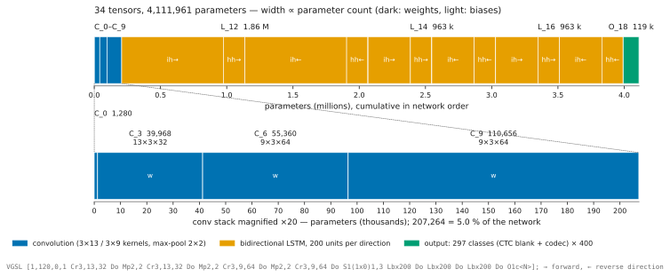
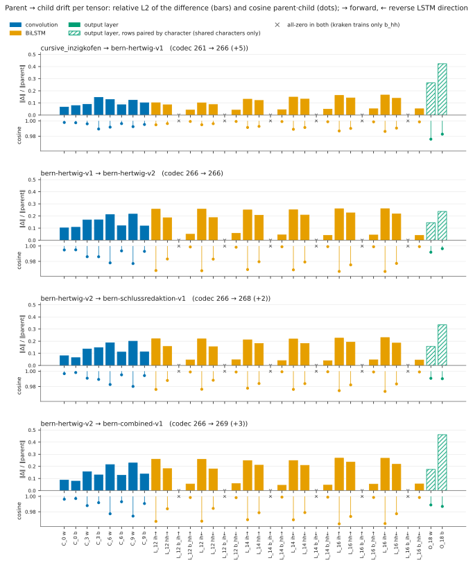
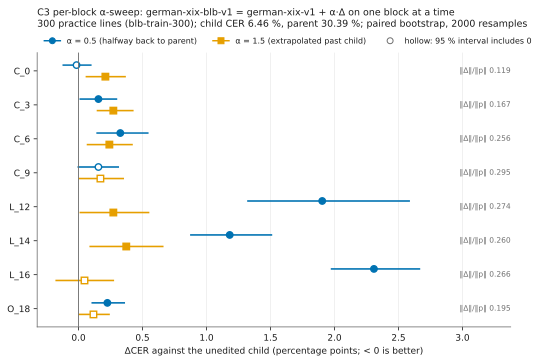
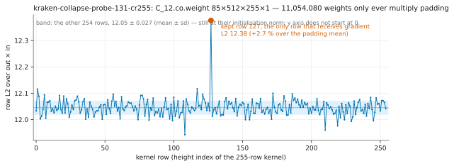

> **Status of this draft.** Third version (8 November 2026): the second version, revised again after the experiments that the internal review asked for (seed null, model zoo, positive control, practice sets that are not training data, sham and interpolation controls, margins, block exchange). Passages marked `[TODO]` need a decision or an experiment; the list is in `paper/STATUS.md`. The first version is kept as `manuscript_v1_draft.md`.

# Abstract

Automatic text recognition (ATR) is routine infrastructure in the digital humanities, yet the models it produces are mostly handled as black boxes: a file and a character error rate (CER). A recent blog post, not peer reviewed, reports that a language model can read the weights of a neural network, hypothesise what its parts do and edit them in code without gradient descent [@takehi_sparks_2026]. We asked what reading and editing weights offers a project that owns a family of text recognition models. We compared 43 kraken models served by our infrastructure as networks, and studied six in-house models and their public parent in depth. Weights recover documented lineage, show that the identical parameters of fine-tuned models are dead units, and show that the first convolutional layers are generic while the recurrent stack is individual. Against a null of five seeds, the rise of the CTC blank bias relative to the other biases is a systematic effect of fine-tuning, whereas the size of a weight change alone is not. In pre-specified editing sessions, a Claude model wrote a whole program in advance from readings; of 15 edits proposed on training lines none improved held-out CER, and on practice lines the models were not trained on one family again gave nothing and the other a small gain that is a plain interpolation toward a sibling model and has no page-level interval excluding zero. A positive control shows that the protocol repairs large localised defects, but a list of hand-written rules does as well as the programmer; only a diffuse defect was repaired by the programmer alone. Systematic exchange of blocks between related models produced one candidate, a Latin incunabula model that reads other print better at no measured cost on its own collection, but with more errors on abbreviation signs. Preparing the experiments exposed two defects in our data: a dataset export in which 44 of 50 training pages carried the wrong image, and a handwriting held-out set of which half was a printed book. Neither was found by reading weights. A first probe at one adapter of a vision-language model transcribing pages (Section 9.3) shows that the machinery transfers, but its one kept edit acted on the length of the output, not on reading, in a metric too unstable to confirm it. The study makes no claim about the internals of language models.

# 1. Introduction

Automatic text recognition has moved, within a decade, from a specialist tool to a standard step in editorial and archival work. Platforms such as Transkribus [@muehlberger_transforming_2019] and eScriptorium [@kiessling_escriptorium_2019] put recognition engines in the hands of historians and philologists, open engines such as kraken [@kiessling_kraken_2019; @kiessling_version_2025] and PyLaia [@puigcerver_pylaia_2018; @tarride_improving_2024] are widely used, and shared datasets and models are collected in catalogues such as HTR-United [@chaque_htr-unitedhtr-united_2021] and in large cross-century resources such as CATMuS [@clerice_catmus_2024]. A special issue of this journal took stock of the field for historical documents [@pinche_historical_2024], and the questions of provenance that follow from sharing training data and models have been discussed there as well [@romein_exploring_2024]. The consequences of the technology for scholarly practice have been described from several sides [@terras_inviting_2021; @hodel_konsequenzen_2018].

The technical core of most of these engines has been stable for even longer: a convolutional feature extractor, a stack of recurrent layers, and a connectionist temporal classification (CTC) output layer that lets the network emit characters without segmenting the line into letters [@graves_connectionist_2006; @graves_offline_2009; @puigcerver_are_2017]. A recognition model is therefore a small object. The models studied here have about four million parameters and fit into a file of 16 megabytes. Box 1 explains the terms used.

> **Box 1. Terms used in this article.**
> *Line recogniser*: a network that reads one image of a text line and outputs a character sequence. *CTC and the blank symbol*: the network emits, for each narrow vertical slice of the line (a frame), a probability for every character of its alphabet and for a special "blank"; repeated characters and blanks are then collapsed, so most frames are blank and each character appears as a brief spike. *LSTM*: a recurrent layer that carries information along the line; kraken uses three bidirectional ones. *Codec*: the list of characters a model can output; its last layer has one row per entry. *Weights, bias, row, block*: the numbers inside the network; a bias is an offset added before the output is turned into probabilities; a block is one layer's weights and biases. *Fine-tuning*: continuing the training of an existing model on new data. *Forward pass*: running the model once over a set of lines. *CER*: character error rate, the share of characters that are wrong. *Practice set, held-out set*: lines the programmer may use to test an edit, and lines it never sees. *Bootstrap interval*: a range for a difference obtained by resampling lines; if it excludes zero the difference is unlikely to be chance (under the assumption that lines are independent). *Relative change*: the length of the difference between two weight tensors divided by the length of one of them.

In practice such a model reaches a researcher as a file and a CER. When a model performs worse than expected, or a fine-tuned child performs worse than its parent, the usual response is to collect more ground truth and retrain. Whether the model has a localisable defect, what fine-tuning changed, and whether two models that share a parent differ in one place or everywhere are questions the usual workflow cannot ask. An introduction for humanities readers describes the recogniser as something that learns to match pixel patterns to characters and to prefer likely sequences of characters [@schonhardt_automated_2026]. That description is a folk model, not something one can check against the weights.

This article tests how far the weights themselves can answer such questions, and whether a language model can help in reading and editing them. It follows an idea from a recent blog post on weight-space programming [@takehi_sparks_2026]: a language model with access to a network's weights, a Python sandbox and a small budget of forward passes can hypothesise what parts of the network do, test the hypothesis and edit the weights in code. We treat this as a "white box" counterpart to the black-box evaluation that dominates the field, and apply it to a family of recognition models whose training history we know. The result is mostly negative, and we report it as such.

**Contributions.**

1. A protocol for weight-space sessions on text recognition models that makes every number traceable: practice and held-out sets with an overlap audit, hypotheses with predicted effects written before the first forward pass, a keep rule, paired bootstrap intervals, and the identity of the programmer model (Section 3).
2. A reading of five pairs of related kraken models with a seed-variance null, a weight-and-function comparison of 43 served models, and per-block and global interpolation of one fine-tune (Sections 6 and 7.2).
3. Two budgeted editing sessions with held-out evaluations, both without gain, the predictions that failed, and a systematic block exchange between related models that produced one candidate (Sections 7 and 8).
4. A positive control with planted defects and a repetition of both sessions on practice sets that are not training data (Sections 7.6 and 7.7).
5. Two defects in our own data that preparing the sessions exposed, and the changes to held-out sets that followed (Appendix A).

A sixth item is a side result and not a contribution of the method: the lossless removal of 11,054,080 weights that never receive a gradient from a kraken-based architecture (Section 7.5).

# 2. Text recognition models in practice

## 2.1 A growing variety of models

The variety of models in circulation has grown with the number of projects that train their own. The kraken project's repository of shared models held 48 models covering 18 writing systems when the fifth version of the engine was described [@kiessling_version_2025]. Transkribus publishes a list of public models [@readcoop_public_2021]. General models for specific scripts, such as German Kurrent, have been trained to serve many projects [@hodel_general_2021], and cross-century datasets are used to train models meant to generalise across hands [@clerice_catmus_2024]. Models built for one corpus are often reused as the starting point for another, so families of fine-tunes arise: a medieval model is adapted to an early modern hand, and the result to a second project.

The standard kraken setup is stable. Its default recogniser is a hybrid of a stack of four convolutional layers followed by three bidirectional LSTM layers of 200 units and a linear output layer, defined in a compact specification language and trained with CTC [@kiessling_version_2025]. All the models of this study share one such specification (Section 6.1), which is what makes it possible to compare their weights tensor by tensor. A survey of the weights of public models (Section 6.4) shows that 21 of 30 public kraken models served by our gateway have exactly the architecture of the models studied here.

## 2.2 The models of this study

The models form two families (Table 1). Family 1 concerns the Bern Disputation of 1528, in the hands of two projects (the Hertwig volume and the Schlussredaktion). It starts from a public medieval model, `cursive_inzigkofen`, itself a fine-tune of CATMuS Medieval, and has four members. Family 2 concerns the Kurrent hands of the Laßberg papers (nineteenth century) and has two members, a general Kurrent model and its fine-tune on the project's own ground truth. `[TODO: spell out the holding institutions and archival signatures; confirm with the project how the hands should be described.]` A third family of kraken+ models trained from scratch was planned and dropped, because the training and validation data of the archived checkpoints were not preserved (Appendix A.3). In what follows, "the models" are the six in-house models and the public parent; they are seven files with one architecture.

| Model | Parent | Training data | Reported CER (trainer record) |
|---|---|---|---|
| `bern-hertwig-v1` | `cursive_inzigkofen` | Hertwig project, 1,786 lines | 27.1 % (test), under-trained |
| `bern-hertwig-v2` | `cursive_inzigkofen` | same, higher learning rate | 23.3 % (test) |
| `bern-schlussredaktion-v1` | `bern-hertwig-v2` | Schlussredaktion, 118 pages, 3,457 lines | 16.7 % (held-out) |
| `bern-combined-v1` | `bern-hertwig-v2` | both projects, 168 pages, 5,441 lines | 28.8 % (held-out), see Appendix A.1 |
| `german-xix-v1` | to be confirmed | Kurrent corpora, 15,527 pages | 11.18 % (document-level held-out) |
| `german-xix-blb-v1` | `german-xix-v1` | four handwriting projects of the Laßberg ground truth | 8.7 % (held-out) |

: The in-house models. Reported values are the trainer's records, copied from the project's model inventory, and were not all measured on comparable sets (Appendix A). The line counts of the first two projects (1,786 and 3,457) do not add up to those of `combined-v1` (5,441); the difference is unexplained. `[TODO: ask the trainer.]` {#tbl:models}

Every number that Sections 6 to 8 report as a result was measured again in this study, on sets whose composition is documented and audited.

# 3. Weight-space programming and our adaptation of it

## 3.1 The idea

The blog post that motivates this study reports that a general-purpose language model, working in different set-ups, can recover what a network was trained to do from its weights alone, repair a failing network and write small networks from scratch [@takehi_sparks_2026]. Its larger experiments give the model a Python sandbox in which it can read and save tensors but not run the network, and a budget of forward passes. The headline example is a small language model whose accuracy on a mathematics benchmark rises from 7.9 to 48.1 percent after the agent found a direction, written by the MLP blocks of two layers, that caused reasoning loops, and subtracted it from 64 output columns in each of them, 0.016 percent of the weights. The effect depended on the budget: with ten forward passes the accuracy was 12.3 percent, with 25 it was 14.1, and only with 50 did it reach 48.1. The authors call the approach weight-space programming and describe their results as very early. They also report a control in which the procedure applied to a smaller model could not improve it, and conclude that "[e]diting weights could remove an obstacle that hid an ability, but it could not add an ability the model lacked". The networks in the post are multilayer perceptrons, small transformers and two language models. We found no report of the approach applied to a convolutional-recurrent network with a CTC output.

Three features of this idea matter for a humanities project. It treats the weights as a text that can be read, which promises a kind of transparency that evaluation on test sets cannot give. It treats the language model as an instrument with a budget, so that each forward pass it spends is accounted for. And it makes a falsifiable claim: if a model has an identifiable defect, reading should find it and a small edit should remove it.

## 3.2 Our adaptation, and how it differs

We follow the post's vocabulary but our implementation is more constrained, and the differences limit what the results can show. A session has one **subject** (a model with a digest), one **practice set** of 300 lines from the training side of the data, one **budget** of forward passes (ten, the lowest budget of the post's language-model experiment), and one **held-out set** that the programmer never sees.

1. The weights are loaded into a sandbox without network access, optimiser or training data. The programmer is a language model running in Claude Code. It does not see raw tensors in its context. It has the practice set and a document of weight readings (Section 6), tables of per-tensor statistics produced by our code and written in the first phase of the project by a Claude Code session whose model identity was not recorded. The programmer's code can load the tensors in the sandbox. Whether a language model can read raw weights, the post's central premise, is therefore not tested here.
2. Before the first pass, a preregistration file states, for each hypothesis, a predicted direction and size of the change in CER on the practice set and the edit class that would test it. We call it pre-specified and logged: it is a file in the project's own repository, written by the programmer model, with no external time stamp.
3. **The programmer writes the whole program in advance** and the sandbox runs it unattended. The post's agent interleaves edits and passes, and reacts to results. Ours cannot. We chose this so that predictions are fixed before any measurement; the consequence is that a budget of passes bounds the program but does not shape it, and the sessions test "a language model writes a list of edits from readings", not the interactive method of the post.
4. After each edit a pass over the practice set measures CER, word error rate, the number of collapsed lines and the confusion pairs. The first session kept an edit if practice CER fell and the number of collapsed lines did not rise; the second, after the protocol was tightened, kept an edit only if the paired bootstrap 95 percent interval of the CER difference against the last kept state lay entirely below zero.
5. At the end the session is frozen and the held-out set is scored once. A difference whose interval includes zero is reported as no gain.

The programmers were Claude Fable 5.1 (`claude-fable-5-1`) for the first session and Claude Opus 5.5 (`claude-opus-5-5`) for the second, both in Claude Code on the project's research server. These identities are as recorded in the session files; no provider log was available. The sessions ran on the CPU path, because the program requests the CPU device, and a pass over 300 lines took about 20 seconds with 12 threads; the sandbox command lines of these two sessions nevertheless name a GPU variable, which we have not been able to rule out as a template. The programmers of the control experiments in Sections 7.6 and 7.7 were different: fresh subagents of Claude Sonnet 5.5 (`claude-sonnet-5-5`), shown only a reading pack of tensor statistics, the diff to the parent and the baseline reading, who wrote a program in advance and never ran it, plus two fixed programs written by the authors' Claude Sonnet 5.5 session before any pass.

Control conditions are defined for each model family: a no-op round trip, the parent, a uniform average of siblings, a per-block interpolation between parent and child, a short retraining on the same data, a sham edit of the same size and a blind programmer without passes. Only the round trip, the parent and the interpolation were run, and the interpolation is a sweep on the practice set, not a control for the sessions. The others are open (Section 10).

# 4. Research questions

The plan had two tracks, patching one model at a time and comparing the family, and the weight of the study moved to the first as results came in. We ask three questions.

**RQ1 (reading).** What do the weights of related text recognition models tell about how fine-tuning changed them? Where do parent and child differ, are the differences consistent across fine-tunes, and do they agree with the models' behaviour on the same lines?

**RQ2 (adaptation).** Can a language model that is given readings of the weights propose edits, under a small budget of forward passes, that improve a recognition model on held-out data, or undo a defect, better than obvious alternatives?

**RQ3 (combination).** Do the readings predict which edits work? Does what weights show about a model's history carry information about what can be done to it?

We registered one expectation before any measurement. The post's own evidence suggests that gains come from removing an identifiable obstacle and not from adding ability. On a healthy fine-tune we therefore expected at most a point or two of CER, and a larger gain only where a model carries a defect that reading can find: a collapse in CTC output, a dead or skewed output row, a layer wrecked by a fine-tune. A negative result, with the infrastructure still useful, was named as a risk in the plan.

# 5. Related work: explaining and editing text recognition networks

We searched for earlier work on analysing, explaining and editing neural networks for text recognition, across arXiv, the ACL Anthology, dblp, Crossref, HAL, Zenodo and, partially, OpenAlex; 72 papers were examined individually, 58 from open full text. The full texts were read by language-model reading agents working to a fixed template, and the lead author checked a sample of quoted numbers against the sources. The protocol, the query log and the coverage gaps are documented in the repository (`docs/SEARCH_LOG.md`, `docs/RELATED_WORK.md`). IEEE Xplore, Google Scholar, Scopus and Semantic Scholar could not be searched, so statements of absence below are bounded by this search.

## 5.1 Explanations for text recognition exist, but are narrow

Explainability studies for text recognition are few and each covers a narrow case. For CTC recognisers, integrated gradients have been applied to a page-level model [@yousef_origaminet_2020], a built-in association map has been proposed for a vision transformer with a CTC head [@buoy_explainable_2023], and per-character attribution has been compared across six scene-text models [@ty_scene_2023]. For handwriting, attention maps are shown for paragraph and line models [@coquenet_towards_2022; @hamdan_htr-jand_2024]. The validation of these explanations is thin. Maps are mostly judged by eye, one study uses a single metric both to choose and to compare methods, and only one study of handwriting-related networks tests a saliency map against a random order, finding on one backbone scores below chance [@pundy_transparency_2025]. We found no survey of explainability for text recognition.

## 5.2 How earlier work assessed what a network does with text

Most work assesses behaviour from the outside. Five kinds of assessment recur.

1. **Input manipulation with an exact ground truth.** The closest study to ours in subject trains a recurrent CTC line recogniser on synthetic English text and probes it with shuffled characters and with seen and unseen character sequences; it finds that the network uses about five characters of context [@sabir_implicit_2017]. More recent studies of vision-language models render perturbed or random text and score against the perturbed string [@karamolegkou_reading_2026; @liang_visual_2026]. The former includes kraken as a black-box baseline and finds it affected much less by character-level scrambling than the vision-language models, without examining its weights.
2. **Swapping decoders or modules.** External language models fused at decoding time still lower the error of recurrent CTC networks, which shows that the recurrent layers do not saturate the language signal but cannot show what they encode [@tarride_revisiting_2024; @moysset_are_2018]. Removing the recurrent layers and retraining raises error considerably [@coquenet_have_2019].
3. **Attribution and attention maps**, as in Section 5.1.
4. **Mechanistic analysis of heads, neurons and hidden states**, which exists only for transformer-based vision-language models [@baek_how_2025; @huangfu_retrieval_2026].
5. **Structure of CTC output itself.** In speech recognition, CTC output has been shown to consist mostly of blank frames with brief label spikes [@zeyer_why_2021; @jung_blank_2023], and in one streaming speech model spike positions are systematically offset from the position of a token [@zeyer_gradient-based_2026].

None of these studies intervenes on the recurrent layers of a trained CTC recogniser. In the literature on kraken the engine appears as a baseline, in training experiments on image pre-processing [@jacsont_impact_2023] and in a description of its architecture [@kiessling_version_2025].

## 5.3 Editing and interpolating weights

In language models, differences between weights have been treated as editable objects: task vectors [@ilharco_editing_2022], averages of fine-tuned models [@wortsman_model_2022], merges that resolve interference [@yadav_ties-merging_2023], located factual associations [@meng_locating_2022], and a single direction that mediates refusal [@arditi_refusal_2024]. Interpolation between trained networks is studied as linear mode connectivity [@frankle_linear_2019; @entezari_role_2021], and collections of trained networks have been assembled as data objects for weight-space analysis [@schurholt_model_2022]. For text recognition we found four related operations: averaging task vectors of fine-tuned word recognisers with a CTC loss and then fine-tuning on a new script [@molina_rodriguez_ocr_2025], zeroing neurons selected by activation contrast and then fine-tuning to unlearn writer identity in a transformer recogniser [@kang_preserving_2026], freezing prefixes of layers during fine-tuning [@sharma_trocr_2026], and an SVD of the output matrix of an LSTM for digits, which we could read only in abstract [@zervakis_multivariate_2019]. All judge their result by accuracy or by a privacy test, not by what the edit does to the network's handling of text.

## 5.4 What is new here

In this search we found no earlier work that treats a trained CTC line recogniser as an object to be read and edited in weight space, with edits proposed from a reading of the weights under a forward-pass budget and checked on a held-out set. Weight-level operations on text recognisers exist, so the claim is narrow. A further finding matters for what follows: the closest published evidence on the architecture we study is behavioural, and the "implicit language model" of its recurrent layers has been inferred from accuracy gaps and never probed directly.

# 6. Reading the weights of related models

## 6.1 Material and method

All the models share one architecture, written in kraken's specification language as four convolutional layers with pooling and dropout, a collapse of the height axis, three bidirectional LSTM layers of 200 units and a linear output layer over the model's codec. The models have between 4.08 and 4.11 million parameters in 34 tensors. The output layer has one row per codec entry and 400 columns. In every LSTM layer kraken stores an all-zero input bias, so those tensors cannot differ between models. The convolutional stack holds about 5 percent of the parameters.

For each pair we computed, per tensor, the relative change (the length of child minus parent divided by the length of the parent) and the cosine between the two. For the output layer we aligned rows by character and not by index, because every fine-tune had grown its codec and an index-wise comparison would silently compare different characters. No forward pass is needed. The behaviour of the models on the same lines, as CER and confusion pairs, was measured separately on practice sets (Section 7.1).

{#fig:arch}

## 6.2 Behaviour on the practice sets

Table 2 gives the CER of each model on 300 lines of the training side of the data. These are not results about generalisation: a fine-tuned model reads its own training lines better than any others. They are the baselines against which edits are measured, and the parents' values on the same lines show how far each fine-tune moved its model.

| Practice set | Model | CER (%) | Collapsed lines |
|---|---|---:|---:|
| Hertwig lines (300) | `cursive_inzigkofen` (parent) | 70.6 | 23 |
| | `bern-hertwig-v1` | 17.7 | 19 |
| | `bern-hertwig-v2` | 8.3 | 12 |
| | `bern-schlussredaktion-v1` | 21.4 | 17 |
| | `bern-combined-v1` | 18.5 | 26 |
| Laßberg lines (300) | `german-xix-v1` (parent) | 30.4 | 23 |
| | `german-xix-blb-v1` | 6.5 | 10 |

: CER on practice sets. The Hertwig lines are the correctly paired images of the 22 October 2026 export (Appendix A.1); they are training lines of `hertwig-v1`, `hertwig-v2` and `combined-v1` and of an ancestor of `schlussredaktion-v1`. The Laßberg lines are training lines of `german-xix-blb-v1`. Collapsed lines by the first definition used (Appendix B). {#tbl:practice}

In every fine-tuned model the most frequent confusion is a deletion, mostly of the space, `e` and `n`; the parent's most frequent confusion on the same lines is an insertion of a space. This pairing is what the readings below were compared with.

## 6.3 What the weights show, and what survives a seed null

Table 3 summarises the five pairs. Four are parent-child fine-tunes. The fifth, `hertwig-v1` against `hertwig-v2`, consists of two runs on the same data and from the same parent with different learning rates. The pairs are not independent: three share `cursive_inzigkofen` and two share `hertwig-v2`, so the observations rest on two families.

| Pair | Codec rows (parent → child) | Conv blocks | LSTM blocks | Output rows, mean | Blank bias change |
|---|---|---:|---:|---:|---:|
| `cursive_inzigkofen` → `hertwig-v1` | 261 → 266 | 0.07 to 0.12 | 0.06 to 0.09 | 0.26 | +0.06 |
| `hertwig-v1` vs. `hertwig-v2` (sibling runs) | same | 0.10 to 0.17 | 0.12 to 0.13 | 0.16 | +0.002 |
| `hertwig-v2` → `combined-v1` | 266 → 269 | 0.08 to 0.18 | 0.12 to 0.14 | 0.19 | +0.118 |
| `hertwig-v2` → `schlussredaktion-v1` | 266 → 268 | 0.07 to 0.16 | 0.11 to 0.12 | 0.17 | +0.056 |
| `german-xix-v1` → `german-xix-blb-v1` | 224 → 296 | 0.12 to 0.30 | 0.26 to 0.27 | 0.19 | +0.113 |

: Lineage readings. Conv and LSTM columns give the range of the relative change over the four convolutional and the three LSTM blocks; output rows are aligned by character. {#tbl:lineage}

The first readings suggested four regularities: rows of rare characters inflate, the blank bias rises, the first convolutional block hardly moves, and the convolutional stack moves less than the recurrent one. A reviewer pointed out that two independent runs of the same fine-tune differ almost as much as the sibling pair does, so we established a null. We fine-tuned the public parent five times on the same Hertwig data with the recipe of `hertwig-v2` (91 epochs, GPU) and different seeds only (`docs/SEED_NULL.md`; the page split is ours, so `hertwig-v2` is a comparison and not a member of the null). Two such runs differ by 0.12 to 0.15 in the output rows and by 0.10 to 0.21 in individual convolutional blocks, against 0.41 in the rows and 0.14 to 0.24 per block between the parent and the same runs. The sibling pair of Table 3 (0.16) differs by about what seeds differ by, so the size of a weight change taken alone does not separate a fine-tuning effect from noise; for the first convolutional block (0.09 to 0.14 between seeds, 0.14 to 0.15 from the parent) and the first recurrent block (0.153 to 0.157 and 0.15) it does not separate them at all.

*What survives the null.* The blank bias relative to the other biases rises by 0.53 to 0.55 in every run and varies by −0.02 to +0.01 between seeds; `hertwig-v2` shows +0.52. The raw rise of about 0.06 is the same in every run and varies by −0.004 to +0.008 between seeds. The output probabilities are unchanged if a constant is added to every bias, so the relative value is the one that matters, and it is larger than the raw one because the other biases fall in every pair; in the four in-house parent-child pairs it rises by 0.16 to 0.57. Rows of rare characters grow and lose bias only from the parent (median norm ratio 1.23, median bias change −0.73 to −0.77 against 1.00 and −0.02 to +0.03 between seeds), where they also move more than the frequent letters; between seeds they move less, and the rows that differ most between seeds are those of characters new to the codec, whose starting values are random. In the recurrent stack the movement grows with depth from the parent (`L_12` < `L_14` < `L_16`) and shrinks with depth between seeds.

*What does not survive.* That the first convolutional block hardly moves, and that the movement of the convolutional blocks grows with depth, appear equally between seeds and are no evidence of fine-tuning. The claim of our first readings that the convolutional stack moves less than the recurrent one was not supported by their own tables and is withdrawn. The CER of the fine-tuned model varies with the seed by a standard deviation of 0.2 points (0.3 on the Hertwig pages), so differences below about one point between two runs of this recipe cannot be interpreted. The null is limited to one parent, one dataset and one recipe, and the criterion for "rare" is a proxy (characters outside basic Latin, digits and ASCII punctuation), not a corpus frequency.

{#fig:drift-bern}

{#fig:drift-xix}

{#fig:rows-xix}

## 6.4 A comparison across a model zoo

Two analyses compare the models that our infrastructure serves, both without any training: a comparison of 43 kraken models as networks, weight by weight and by function (`docs/MODEL_FAMILY.md`), and a survey of the weights of the 30 public models of them that could be fetched (`docs/ZOO_SURVEY.md`; seven were refused by the repository). The 43 are 37 models published on Zenodo and six trained in-house. The two analyses agree where they overlap.

**Five architectures, one majority.** 33 of the 43 models (77 percent) have the default kraken layout at a line height of 120 pixels, the layout of the models studied here; six use a group-normalised variant, two a larger default layout, and two are singletons. Models compare element by element only within an architecture group.

**Lineage can be read from weights.** The cosine between the non-output weights of two models separates three bands over the 544 comparable pairs: 496 pairs below 0.2 (unrelated), 7 between 0.2 and 0.5 (distant relatives) and 41 above 0.6, which includes every recorded fine-tune. The weights agree with the documented bases in 11 of 13 documented pairs. They contradict two stated bases (one model names a base with which its weights are unrelated, another has a different architecture from the base it names), they show that two models with no stated base descend from one in the family, and they identify the base of the Kurrent model that our inventory marked "to confirm" (cosine 0.756). The other 22 models are singletons, trained from scratch or from a base that is not served.

**What is identical is dead.** No live parameter is identical between unrelated models, and within every lineage the only identical parameters are in the first two convolutional layers. These are dead units and not frozen learning: the unchanged filters of the first layer output zero on every frame of a set of probe lines, so no gradient reaches them, and the unchanged weights of the second layer are exactly those that read them. Eleven of the 43 models have no dead first-layer filter and eleven have a third or more (up to 19 of 32). No layer is identical enough to have been frozen as trained; the identical part is capacity that does nothing.

**Function: a generic front end and an individual recurrent stack.** The similarity of two models' outputs per layer (linear CKA on 120 probe lines) falls with depth in every group. In the default group, models of one lineage have a similarity of 0.85 in the first convolution, 0.62 in the first LSTM layer, 0.39 in the last and 0.19 at the output; unrelated models start at 0.80 and end at 0.04. In the group-normalised variant the first layer is functionally the same in all six models (0.99), unrelated ones included. The front end is generic in function even where it shares no weights; the last recurrent layer and the output layer are where models are individual.

**Two observations generalise, two do not.** Relative to the other biases the blank bias rises in 11 of 11 documented parent-child pairs and is positive in 39 of the 40 models surveyed; the exception is a typewriter model. Rows of special characters grow in norm and lose bias in 10 of 11 pairs, but not selectively and not at the size first stated: the rows that moved most are the rare ones in only 6 of 11 pairs. The ten most frequent letters have the weakest rows in every one of 37 models that contain them (median norm ratio 0.50 against the other rows). The convolutional stack does not move less than the recurrent one (conv below the LSTMs in 2 of 5 independent public pairs), and the first convolutional block moves least in 11 of 11 pairs, which the seed null shows to be a property of noise as well.

These analyses cannot say whether the public models were trained like ours; "rare" is a proxy; nothing was scored, so no weight pattern predicts a CER; and the five independent public pairs come from three parents and three architectures.

## 6.5 What the readings did not find

The reading gave one result that mattered, and it was not a result about weights. The pair `hertwig-v2` → `combined-v1` was chosen as the first target because the trainer's records gave the child a held-out CER of 28.8 percent against 16.7 percent for its sibling. Measuring the models on a practice set revealed that the child had been trained on a dataset export in which most Hertwig training pages carried the wrong image (Appendix A.1). The weight profile of the child, the largest blank-bias shift of the family and strongly inflated rare rows, was read as consistent with training on label noise only after that was known. We did not test whether it would have indicated label noise without the independent evidence.

# 7. Editing the weights

## 7.1 Protocol, sets and their limits

A session needs two kinds of data that must not overlap. The **practice set** is seen by the programmer; the **held-out set** is scored once after the session is frozen. Practice sets are 300 lines cut from the training side of the data, so they are lines the subject was trained on. This is a design weakness and not a detail: an edit is kept by its gain on lines the network has fitted, so the keep signal measures fit and not generalisation, and a donor model that was trained on the same lines (Section 7.4) shows the consequence. The two sessions of Sections 7.3 and 7.4 are not corrected for it; Section 7.7 repeats them on practice sets from a validation side that the subject was not trained on. Held-out sets are built from the object-level evaluation projects and audited against every practice list and against the corpora the subject was trained on. The audit itself had to be corrected twice (Appendix B).

For every reported difference we compute a paired per-line bootstrap interval (2,000 resamples, fixed seed). Lines are resampled independently, although they cluster in pages and objects (545 lines from 14 pages in the second session, 5,628 lines from 33 objects in the first), so the intervals are narrower than they should be. A resampling by page or object would widen them and has not been done. The keep rule was tightened after the first session (Section 3.2), and sequential decisions within a session carry no correction for multiple tests. All sessions are reported, including edits that were reverted.

## 7.2 A sweep: where does a fine-tune's gain sit?

Before any edit we measured where the gain of the Kurrent fine-tune lies on the practice set. For each of eight blocks (four convolutional, three LSTM, the output layer) in turn, we set the block to `parent + α (child − parent)`, leaving all other blocks as in the child, and scored the practice set at α = 0.5 and α = 1.5 (Table 4). For the output layer the 225 shared rows were interpolated and the 72 rows that only the child has were kept. The child reads the practice set with a CER of 6.46 percent and the parent with 30.39 percent, a gap of about 24 points. The held-out set was not touched, and the protocol lists two more values of α that were not run.

| Block | Relative change child − parent | Δ CER at α = 0.5 (points) | Δ CER at α = 1.5 (points) |
|---|---:|---|---|
| first conv | 0.119 | −0.02 [−0.13, +0.10] | +0.21 [+0.06, +0.37] |
| second conv | 0.167 | +0.16 [+0.01, +0.30] | +0.27 [+0.14, +0.43] |
| third conv | 0.256 | +0.33 [+0.14, +0.55] | +0.24 [+0.06, +0.42] |
| fourth conv | 0.295 | +0.16 [−0.01, +0.32] | +0.17 [+0.00, +0.36] |
| LSTM 1 | 0.274 | +1.90 [+1.32, +2.59] | +0.27 [+0.01, +0.55] |
| LSTM 2 | 0.260 | +1.18 [+0.87, +1.51] | +0.37 [+0.09, +0.66] |
| LSTM 3 | 0.266 | +2.31 [+1.97, +2.67] | +0.05 [−0.18, +0.28] |
| output layer | 0.195 | +0.23 [+0.10, +0.36] | +0.12 [+0.00, +0.25] |

: Per-block interpolation between parent and child of the Kurrent pair, practice set of 300 lines; difference against the unedited child with paired bootstrap 95 % intervals. {#tbl:alpha}

{#fig:alpha}

Halving the move of any single block costs at most 2.3 points. The eight halvings add up to about 6 points, a quarter of the 24-point gap. That is what an additive loss surface predicts: if each block's contribution grows with the square of its distance from the child, halving a block's move costs a quarter of its contribution, and the sum over blocks is a quarter of the gap. The sweep therefore gives no evidence for strong interactions between blocks, and our first draft's reading, that the gain is held jointly, is not supported. A test of interactions would interpolate all blocks together and pairs of blocks and compare the sum of single-block effects with the joint effect; it has not been run. Two observations stand. The recurrent blocks carry the largest single-block effects at α = 0.5. And only LSTM 3 tolerates extrapolation to α = 1.5, where the costs of LSTM 1 and 2 fall from 1.9 and 1.2 to 0.3 and 0.4 points, an asymmetry we cannot explain. For LSTM 3 we looked at the confusions: halving it leaves the letters but loses word boundaries (deleted spaces rise from 103 to 263, word error rate from 17.1 to 31.9 percent). We did not break the other recurrent blocks down in the same way, so the localisation of spacing to the last block is shown for that block only. The second convolutional block, which contains the tensor that moved most in the reading (its bias, relative change 1.09), costs 0.16 points when halved; the bias alone was not tested.

## 7.3 Session 1: the Kurrent production model

The first budgeted session used `german-xix-blb-v1` as subject, the 300-line Laßberg practice set and a budget of ten passes. The programmer registered eight hypotheses from the readings, each with a predicted size (Table 5). All concerned the output layer, because the readings had pointed there: the blank bias, the space row, the twelve rows that moved most, and the rows of the frequent letters. The eighth hypothesis was conditional on nothing having been kept; the first was kept, so it was not run. The session therefore used eight passes (the first is the baseline), proposed seven edits and kept two; passes nine and ten stayed unspent because the program had no further step. The notes written after the run add that a third size of the blank bias would have fitted the practice set. The session ran under the first keep rule, and changed one element of one tensor (the blank bias, 1.2323 to 0.2323).

| Hypothesis | Edit | Predicted ΔCER (points) | Practice CER, % (Δ vs. unedited, points) | Decision |
|---|---|---|---|---|
| H1 blank bias back to the parent's value (−0.113) | add to bias | −0.1 to −0.5 | 6.44 (−0.02) | kept |
| H2 blank bias −0.5 in total | add | a further −0.3 to −1.0 | 6.51 (+0.05) | reverted |
| H3 space bias +1.0 | add | −0.2 to −0.6 | 6.47 (+0.02) | reverted |
| H4 space bias +0.5 | add | −0.1 to −0.3, or a rise | 6.49 (+0.03) | reverted |
| H5 twelve most-moved rows from the parent | set rows | \|Δ\| < 0.05 (a null) | 6.46 (0.00) | reverted (a tie reverts) |
| H6 rows of frequent letters × 1.1 | set rows | −0.2 to −0.5 | 6.51 (+0.05) | reverted |
| H7 blank bias −1.0 in total | add | as the step above | 6.44 (−0.02) | kept |

: Session 1 (`german-xix-blb-v1`, 300 practice lines, 12,867 characters). Predictions were written before the first pass; the unedited practice CER is 6.46 %. {#tbl:s1}

Every output-layer lever traded deletions for insertions and substitutions roughly one for one. Lowering the blank bias by 0.5 reduced the deletion of spaces from 103 to 90 and of `e` from 40 to 35, and the error rate rose. Raising the space bias did the same, and the insertions it produced took back the gain. Scaling the frequent rows reduced the deletions of `e` and `n` as predicted and increased substitutions among those letters by more. Only the null prediction, that the twelve typographic rows are inert, was right. Practice CER went from 6.458 to 6.435 percent over the session, a difference of −0.023 points with an interval of [−0.34, +0.30].

The frozen model was scored once on all 5,628 lines of the handwriting evaluation projects (Table 6). The interval contains zero for the whole set and for each of the four projects. The edit is not a gain. Under the keep rule introduced afterwards, which requires the interval to exclude zero, this session would have kept nothing; that is a counterfactual, since the programmer might have written a different program under the other rule.

| Held-out set | Lines | CER before (%) | CER after (%) | Δ (points) [95 % interval] |
|---|---:|---:|---:|---|
| all four projects (33 objects) | 5,628 | 12.335 | 12.325 | −0.010 [−0.048, +0.026] |
| `lassberg_eval` | 446 | 5.27 | 5.32 | +0.050 [−0.037, +0.139] |
| `korrespondenten_eval` | 452 | 24.43 | 24.42 | −0.011 [−0.157, +0.131] |
| `unbestimmt_eval` | 193 | 14.72 | 14.64 | −0.083 [−0.336, +0.162] |
| `manuskripte_eval` | 4,537 | 11.75 | 11.73 | −0.013 [−0.051, +0.027] |

: Session 1, held-out evaluation after freezing; the parent reads the full set with 31.96 % CER. The set was later found to contain material that is not handwriting (Appendix A.2); on the rebuilt handwriting set the same reading gives 9.553 % before and after, a difference of −0.001 points. {#tbl:s1heldout}

## 7.4 Session 2: undoing damage from label noise

The second session targeted `bern-combined-v1`, with a practice set of 300 lines from both of its training projects (103 Hertwig lines with the correct images of the 22 October export and 197 Schlussredaktion lines of the 24 October export) and a held-out set of 545 lines from the test pages of the two projects (14 pages). The question was whether a weight edit can undo training on partly wrong labels, with the parent and the clean sibling as donors. Eight hypotheses were registered, all expected to be refused or to change little: the blank bias back to the parent's value; each of the output layer, the three LSTM layers and the whole convolutional stack transplanted from the sibling; the output layer transplanted from the parent; and the last LSTM layer interpolated halfway towards the parent (Table 7). The session used nine passes and proposed eight edits under the interval keep rule.

| Hypothesis | Registered expectation | Practice CER, % (all / Hertwig / Schlussredaktion) | Decision |
|---|---|---|---|
| H1 blank bias to the parent's value | −0.2 to +0.2 points, probably refused | 14.5 / 20.4 / 11.8 | refused (interval contains 0) |
| H2 output layer from the sibling | refused | 14.6 / 20.4 / 11.9 | refused |
| H3 LSTM 3 from the sibling | refused | 15.1 / 21.3 / 12.2 | refused (CER rose) |
| H4 LSTM 2 from the sibling | refused | 15.1 / 21.2 / 12.3 | reverted (collapsed lines rose) |
| H5 LSTM 1 from the sibling | refused | 14.5 / 19.7 / 12.1 | refused (interval contains 0) |
| H6 conv stack from the sibling | refused | 15.1 / 21.2 / 12.3 | reverted (collapsed lines rose) |
| H7 output layer from the parent | net worse, refused | **14.1** / 19.0 / 11.9 | **kept** (interval [−0.85, −0.04]) |
| H8 LSTM 3 halfway to the parent | within [−0.5, +1.0], probably refused | 14.3 / 17.2 / 12.9 | refused |

: Session 2 (`bern-combined-v1`); unedited practice CER 14.6 % (Hertwig 20.5, Schlussredaktion 11.8). H8 is measured against the state after H7. {#tbl:s2}

One edit was kept: the output layer of the parent, with the 266 shared character rows transplanted and the three new rows retained. Its practice gain of 0.42 points came from the 103 Hertwig lines, which are the parent's own training lines; the parent's output layer fits them, so a transplant from it looks good on practice and does not transfer. On the held-out set the edit changes the CER from 19.33 to 19.48 percent. It trades a gain on Hertwig whose interval contains zero for a loss on Schlussredaktion whose interval, under line-level resampling, excludes zero (Table 8). The edit is not a gain.

| Held-out set | Lines | CER before (%) | CER after (%) | Δ (points) [95 % interval] |
|---|---:|---:|---:|---|
| all (14 pages) | 545 | 19.33 | 19.48 | +0.15 [−0.10, +0.42] |
| Hertwig | 287 | 26.69 | 26.39 | −0.30 [−0.72, +0.13] |
| Schlussredaktion | 258 | 13.48 | 13.99 | +0.51 [+0.21, +0.82] |

: Session 2, held-out evaluation after freezing (parent 27.49 %, clean sibling 20.36 % on the full set). {#tbl:s2heldout}

The session showed a protocol gap that is not yet closed: a donor that was trained on the practice lines biases the keep rule. We propose that a donor must not have been trained on the practice lines, or that the rule be applied only to lines the donor has not seen; it is not yet in the protocol. The session also recorded a harness bug: the function that reports whether an edit was kept returned no value, so the programmer's own printed decision and one reference value in its collapsed-line check were wrong for one edit. The harness decided every edit correctly, and the bug was fixed the same day and recorded as a deviation.

## 7.5 A side result: removing weights that never learn

One operation is not an edit by a language model and works exactly as intended. A kraken-based architecture used in an earlier project of ours ends in a convolution with a kernel of 255 rows applied to a feature map of one row. Only the central row sees data; the other 254 multiply padding and never receive a gradient. They account for 11,054,080 of the 15,207,871 parameters. This was a known property of the architecture, measured in the earlier project, and not a finding of this study. The rewrite keeps the central row, rebuilds the model with a kernel of one row and copies every other tensor unchanged. The result reads the same 300 lines with identical text, the largest difference between output probabilities is 1.1 × 10⁻⁶ (rounding in single precision), and the file loads through the serving engine. The padding rows of the checkpoint sit at their initialisation norm (12.045 ± 0.027 against 12.38 for the live row), as weights that never receive a gradient must. The rewritten model has 4.15 million parameters, about 17 megabytes in single precision against 61 for the original. The only checkpoint of this architecture still available was a collapsed training run, so the equality of outputs demonstrates the rewrite and not the quality of a recogniser; the archived models of the same project already used the smaller layer.

{#fig:padding}

## 7.6 A positive control: planted defects

The review of the first draft asked whether the method can find a defect that is known to exist. We corrupted `german-xix-blb-v1` in eight known ways and ran the session protocol on each corrupted copy, with the held-out set of 2,272 handwriting lines (the uncorrupted model reads it with 9.55 percent CER). Four arms were compared: (a) a programmer with a budget of ten passes; (b) a blind programmer with no pass at all, who had only the readings; (c) a fixed, hand-written list of repairs, one rule per kind of defect, written before any pass; (d) a coordinate search over output-layer biases with the same budget. The classes of outcome were fixed before the first pass: repaired if at least 80 percent of the damage is recovered and the paired interval of final against corrupted lies below zero, partly between 20 and 80 percent, not repaired below 20 percent.

| Corruption | Damage on held-out (points) | (a) programmer | (b) blind | (c) hand-written list | (d) bias search |
|---|---:|---|---|---|---|
| zero the output row of `e` | +10.10 | repaired (9.57) | repaired (9.76) | repaired (9.72) | partly (12.56) |
| negate the row of `n` | +60.69 | repaired (9.55) | repaired (9.55) | repaired (9.62) | partly (51.59) |
| swap the rows of `e` and `n` | +18.20 | repaired (9.55) | repaired (9.55) | repaired (9.77) | not repaired (27.68) |
| blank bias +2 | +1.30 | repaired (9.52) | repaired (9.55) | repaired (9.50) | repaired (9.55) |
| output weights × 2 | −0.03 | no effect, no edit kept | halved, no effect | no edit | no edit |
| last LSTM block × 0.5 | +11.62 | repaired (9.55) | repaired (9.55) | repaired (9.55) | partly (12.94) |
| noise in the middle LSTM block | +0.49 | no edit kept | no edit | no edit | no edit |
| zero the fourth convolution block | +90.45 | repaired (9.77) | repaired (9.77) | repaired (9.77) | not repaired (100.00) |

: Planted defects in `german-xix-blb-v1`: held-out CER in percent after the session in brackets. One attempt per corruption and arm. Intervals resample lines. {#tbl:planted}

For the six corruptions that cost at least one point (1.3 to 90 points; Table 9), arms (a), (b) and (c) all repaired the model, to within 0.22 points of the uncorrupted CER in each of the 18 cases, and the harness accepted the right edit and refused the wrong ones; the coordinate search repaired only the blank offset and partly three others, and cannot touch a convolution block. The control therefore shows that the keep rule can keep a true repair, so the absence of a kept edit in the first two sessions is not explained by a method that cannot recognise a repair. It shows less than it may seem to. The defects are the kind that the difference to the parent shows at once (a row with a cosine of −0.99, a block of zeros, a block at half the parent's norm); real damage from a bad fine-tune or from label noise is spread over many weights and leaves no such signature. The repairs borrow rows and blocks from the parent, which shares the lineage of the child and so fits it almost exactly. The hand-written list does as well as the programmer, and the blind programmer as well as both: on these defects, the programmer adds nothing over a list of rules, and the forward passes add nothing over the readings. The programmers were fresh subagents, with line-level intervals and one attempt per cell.

We then planted three diffuse defects and removed the parent as a donor (Table 11). Noise of 10 percent of each tensor's norm on every weight (+54 points) cannot be seen in the difference to the parent, because no tensor stands out: the blind programmer correctly wrote that it found no localised defect and did nothing, the hand-written list fired no rule, and only the programmer who could measure found that pulling all non-output tensors a quarter of the way toward the parent averages the noise away (63.8 to 18.5 percent, 83 percent of the damage). This is the one cell of the study in which forward passes bought something that reading did not, and it relies on a donor from the same lineage. Block noise of 60 percent on one LSTM layer was repaired only partly by interpolation toward the parent (51 to 70 percent), and a diffuse scale of 0.9 on all LSTM layers did too little damage to count (+0.31 points). With an unrelated model as the only donor (`kraken-bern-hertwig-v2`), the zeroed row and the zeroed convolution block were not rebuilt (19 and 1 percent), because the donor's rows and filters do not fit this model; the halved LSTM block was undone without any donor.

| Corruption | Damage (points) | (a) programmer | (b) blind | (c) hand-written list | (d) bias search |
|---|---:|---|---|---|---|
| noise 10 % of norm on every tensor | +54.24 | 83 %, repaired | no edit | no rule fired | 6 % |
| noise 60 % of norm on the middle LSTM block | +3.94 | 66 %, partly | 70 %, partly | 51 %, partly | 0 % |
| all LSTM blocks × 0.9 | +0.31 | null by the 0.5-point rule | null | null | null |
| zero row of `e`, unrelated donor | +10.10 | no edit | no edit | 19 % | n/a |
| last LSTM block × 0.5, unrelated donor | +11.62 | 100 %, repaired | 100 %, repaired | 42 % | n/a |
| zero fourth convolution block, unrelated donor | +90.45 | 1 % | no edit | no edit | n/a |

: Diffuse corruptions and an unrelated donor (share of the damage recovered on held-out lines). One attempt per cell, Sonnet programmers. {#tbl:planted2}

## 7.7 Practice sets that are not training data

To address the central design weakness of Sections 7.3 and 7.4, we repeated both sessions on practice sets that the subject was not trained on, audited against the subject's training pages and against the held-out set, with the donor rule that a donor's edit is judged only on lines the donor has not seen. What the trainer's data splits allow differed between the two families.

For the Kurrent model, no validation side exists inside the training projects: every line of the 1,651 training pages was trained on, and the trainer's validation set was the 157 evaluation pages, that is, the pages we use as held-out. They were therefore used for the trainer's checkpoint selection (the best checkpoint by validation accuracy), a mild selection effect that applies to every held-out number we report for this model. We drew seven whole objects from the evaluation side as a practice set (300 lines) and removed them from the held-out set, which then has 1,718 lines and is read by the unedited model with 8.41 percent CER; these numbers are not comparable with the 9.55 percent of the earlier set. On these lines, which are not training lines, the model reads 13.83 percent against 6.46 percent on its training lines, from only seven objects. For the Bern model, the trainer's own validation side (17 pages of 168) was never trained on by the subject, with one complication: all six Hertwig validation pages are training pages of its parent and of the donor `hertwig-v2`.

| Model | Practice set | Attempts | Edits kept | Held-out before → after (%) | Δ held-out (points) [95 % interval] |
|---|---|---|---|---|---|
| `german-xix-blb-v1` | 300 lines, 7 objects | 3 programmers and a replay of the first session | 0 of 28 edits | 8.41 → 8.41 | 0 |
| `bern-combined-v1` | 513 validation lines | 3 programmers (same final model) | 2 of 8 | 19.33 → 18.94 | −0.39 [−0.69, −0.08]; by page [−0.72, −0.06] |
| `bern-combined-v1`, donor rule | replay of the second session | 1 | 1 of 8 | 19.33 → 19.01 | −0.32 [−0.70, +0.07]; by page [−0.67, +0.04] |

: Both sessions repeated on practice sets that are not training data. {#tbl:validation}

For the Kurrent model the keep rule refused every output-layer, blank, space and letter-row edit again. For `combined-v1` the three independent programmer attempts arrived at the same final model, whose two kept edits are a lowering of the blank bias by 0.3 and an interpolation of the non-output tensors one quarter of the way toward the clean sibling. On the held-out set it reads 18.94 percent against 19.33 (Table 10); the gain is −0.49 points on the Hertwig lines (interval [−1.10, +0.04]) and −0.30 on the Schlussredaktion lines ([−0.58, −0.01]). This is the first held-out gain of the project and it is small. It is a model merge toward a sibling that reads the Schlussredaktion hand better, and not a repair of label-noise damage, since its Hertwig part is not significant; the three programmers found it because their reading pack listed the sibling as a donor; and it has not been compared with an average of siblings or a per-block sweep, nor with a sham edit of the same size, so it is not yet established that its content matters. Under the donor rule the output-layer transplant from the parent that the second session had kept is now refused, because it is judged on the 301 lines the parent did not train on (interval [+0.32, +0.83] points): the rule removes the artefact that the first run of the session exhibited. The replay's one kept edit, the first LSTM layer from the sibling, does not clearly transfer to the held-out set.

Two further programmers saw the same packs, an Opus 5.5 and a Haiku 5.5 instance. On the Kurrent practice set neither kept an edit; on the Bern set both moved the model toward the sibling, as all five attempts that kept anything did, and gained −0.19 (Opus) and −0.31 points (Haiku) on held-out lines. The three Sonnet attempts, which had converged on one final model, thus do not reflect the spread of programmers: it is larger, but the direction is set by the donor that the pack names. None of the page-clustered intervals excludes zero (Section 7.8).

## 7.8 Is the one gain a repair, a merge, or noise?

Three checks on the Bern gain (Table 12). Twenty sham edits of the same size, with a Gaussian perturbation of each non-output tensor at the Frobenius norm of the real quarter-step toward the sibling, plus the same lowering of the blank bias, gave a held-out change of −0.013 points on average (standard deviation 0.062, range −0.199 to +0.097); none of the twenty reaches the real −0.39, and the keep rule kept none of them. So the gain is not what random edits of that size do. But it is plain interpolation: the lowering of the blank bias alone changes nothing (+0.01), the quarter-step alone gives −0.31, and the sum −0.39, inside every interval. The gain lives in a narrow window: held-out CER improves for steps of 0.1 to 0.25 toward the sibling, is zero at 0.4 to 0.5, including the uniform average of the two models (−0.02), and is clearly worse from 0.75 on. The practice set ranks the steps wrongly: practice CER keeps falling until three quarters of the way, where held-out is worse by 0.3 to 0.4 points; the keep rule refused the larger steps only because it is conservative. Finally, with intervals that resample whole pages instead of lines, none of the steps excludes zero. Three earlier statements need correction on the same grounds: the significant practice gain of the second session, and the significant loss on the Schlussredaktion lines (a page interval of [−0.04, +1.08]), are line-level results that page-clustered intervals do not support. The conclusion "no improvement" stands; the claim that the edit harmed the Schlussredaktion lines does not.

| Edit on `combined-v1` | Practice CER (%) | Held-out CER (%) | Δ held-out, lines | Δ held-out, pages |
|---|---:|---:|---|---|
| blank bias −0.3 only | 13.71 | 19.34 | +0.01 [−0.09, +0.12] | [−0.15, +0.18] |
| quarter-step toward sibling, no blank edit | 12.51 | 19.01 | −0.31 [−0.61, −0.02] | [−0.77, +0.09] |
| quarter-step and blank −0.3 (the kept edit) | 12.39 | 18.94 | −0.39 [−0.69, −0.08] | [−0.84, +0.04] |
| half-step and blank | 11.54 | 19.29 | −0.04 [−0.43, +0.34] | [−0.62, +0.56] |
| uniform average of both models | 11.65 | 19.31 | −0.02 [−0.43, +0.38] | [−0.62, +0.60] |
| full step (the sibling's tensors) | 11.83 | 20.37 | +1.04 [+0.52, +1.55] | [+0.05, +2.19] |
| 20 shams, mean (range) | 13.82 | | −0.01 (−0.20 to +0.10) | |

: The Bern gain against sham and averaging controls. Practice = 513 validation lines; held-out = 545 lines, 14 pages. {#tbl:sham}

## 7.9 Interpolating the Kurrent pair: additivity

To test the statement that the sweep was consistent with an additive loss surface, we moved all eight blocks of `german-xix-blb-v1` jointly toward the parent, in steps of a quarter from the parent to 1.5 times the child, and compared the cost with the sum of the costs of moving each block alone, on seven objects not trained on (300 lines) and on the 1,718 held-out lines. Nowhere on the line is there a gain: moving any distance from the child toward the parent costs, and extrapolating also costs (+0.29 at 1.25 and +2.05 points at 1.5 on held-out lines). The joint cost is larger than the sum of the single costs on the held-out lines, by +3.81 points at the parent (page interval [+2.57, +4.98]), +2.23 at a quarter, +2.19 at a half and +0.38 at three quarters; on the 300 practice lines the sign is the same but the intervals contain zero. Pairs of blocks at the half-way point, however, are close to additive: the sum of the two single costs predicts the pair's cost with a correlation of 0.98 on the practice lines and 0.97 on the held-out lines, with a mean interaction of +0.11 and +0.07 points. The departure from additivity thus builds up with the number of blocks moved and not within pairs: single blocks and pairs are close to additive, the whole network is not. This replaces the earlier wording and matters for any procedure that assumes block-wise independence.

## 7.10 A block exchange found by search, not by a programmer

The weights of the two families can also be compared by exchange: replacing blocks of a specific model with those of a more general relative from the same lineage, fully or half-way, and reading the practice lines (Section 6.4). This is a systematic grid of 240 readings and not a programmer session, and it gave the one candidate of the study that does something other than a small interpolation. In the first grid, no block's fine-tune could be undone at no cost, the first convolution came closest, the recurrent layers traded one for one or worse, and the output layer was no lever (an exchange of its rows on the shared characters cost or did nothing in every pair); stabilising moves existed only in the convolutional blocks and only toward a general model that reads the other material better. A model of a different architecture family, `kraken-latin_incunabula` (a public Zenodo model), then gave a candidate: its first two group norms replaced by those of its base, `kraken-catmus_print_large`, and its output layer moved half-way to the base, chosen on practice lines, confirmed on disjoint lines and then scored once on 4,374 held-out lines of 60 pages of a dataset of incunable prints (audited as sharing no page, line or crop with the practice and confirmation sets). On the model's own collection it is as good as the original (4.99 against 5.01 percent, Δ −0.03, interval [−0.07, +0.02]); read through the serving path on 58 pages it is better on 40, worse on 17 and equal on one (median page CER 4.05 against 4.16 percent, interval of the median page difference [−0.27, −0.10]). It was chosen for stabilisation on print it was not trained for, which was measured on practice and confirmation lines only (−0.6 to −2.4 points). The block statistics show the price: on the held-out lines the abbreviation signs of the medieval character set (MUFI) get worse, from 532 to 731 errors (+0.11 points of CER, interval excluding zero), while lowercase letters improve (−0.08 points), so a flat total hides a regression for an edition that keeps its abbreviations. The edited model has not been promoted; it is registered and disabled in the serving system.

# 8. The two parts combined: do the readings predict what editing can do?

## 8.1 Predictions against measurements

Both sessions registered expectations before the first forward pass, so the readings can be tested as a source of hypotheses. We separate the mechanism a hypothesis rests on from the sign and size of the CER change it predicts.

In Session 1 the mechanism was right: each lever reduced the deletions it targeted. The sign of the CER change was right for two of the six hypotheses that predicted a gain (H1 and H7, both within noise) and wrong for the other four, and none reached the lower end of its predicted range. The readings had predicted a change of −0.5 to −1 points for the blank bias; the measured change was −0.02 points on practice and −0.01 on held-out, a difference of a factor of 25 to 50. The one hypothesis that predicted a null, the inertness of the typographic rows, was correct.

In Session 2 all eight hypotheses were registered as likely to be refused, and seven decisions were as expected. The registered magnitudes were mixed. The sibling's output layer was expected to worsen the Hertwig lines by one to three points and left them within 0.1 points; the sibling's first LSTM layer was expected to worsen them and improved them by 0.8 points; the output layer from the parent was expected to make the model worse on the whole and improved the practice set. The second session was written after the first, by a different model, with the first session's report at hand, so its better fit of the decisions cannot be attributed to the model, to experience or to the nature of the target. With 15 hypotheses from two programmers no quantitative statement of predictive skill is possible.

## 8.2 Why output-layer edits did not do what the readings suggested

The pattern the readings found in the output layer is real: the blank row's bias rises in the parent-child fine-tunes, and deletions dominate every confusion table. The first session shows that moving the bias does not remove the deletions, since each lever traded them one for one for other errors. This suggests that the deletions are decided upstream of the output layer, and we measured the margins that would show it: for 696 deleted spaces, `e` and `n` in 418 lines of the Kurrent held-out set, 127 (18 percent) have no frame between the neighbouring characters at all, so no bias edit can act on them; for the other 569 the median deleted character sits 3.2 nats below the blank at its best frame (a factor of 24 in probability), and 63 percent are more than two nats away. Lowering the blank bias by 0.1, 0.5 and 1.0 recovers about one deletion in 40, one in 9 and one in 5, and at 1.0 the 152 recovered deletions are paid for with 133 new insertions. The predicted and measured recoveries agree in size. The bias is not the lever; the 37 percent of cases within two nats could be reached only by edits larger than the first session tried, and these trade one error for another. The sweep points in the same direction: single recurrent blocks carry the largest effects at α = 0.5, and halving the last LSTM block loses word boundaries.

## 8.3 Reading and defects

The expectation we registered was that gains come from removing a defect that reading can find. In family 1 a defect existed, a model trained partly on mismatched pages, and reading did not find it: the measurement of a practice baseline did, and the weight profile fitted the explanation afterwards. In family 2 reading found no defect, and the 428 collapsed lines that looked like one were defects of the held-out set (Appendix A.2). In the kraken+ architecture there is a defect that reading can find, because it is a property of the architecture, and it was known before the study; the rewrite was made by code and not by a programmer session. The three results fit the registered expectation. They do not test the stronger claim that reading would identify a defect in a trained recogniser, because the one defect we know to exist in a trained model was invisible to the readings.

## 8.4 Answers to the research questions

**RQ1.** Reading weights across lineage pairs is cheap, needs no forward pass, and shows consistent traces of fine-tuning in the output layer (Section 6.3), and a seed null of five runs shows which of them are specific to fine-tuning (the rise of the blank bias relative to the other biases, the growth of rare rows) and which are not (the depth pattern of the convolutional stack, the claim that rare rows move most; Section 6.3). Across 43 models the lineage can be recovered from weights for fine-tunes that did not move far (Section 6.4). The traces agree in direction with the confusion tables. They did not localise the gain of any fine-tune.

**RQ2.** Under a budget of ten passes, and keep rules that differed between the sessions, none of the 15 edits proposed in the two sessions on training lines improved a model on held-out data: seven edits in Session 1 (two kept) and eight in Session 2 (one kept), with held-out differences of −0.010 and +0.15 points whose intervals contain zero. Repeated on practice sets that are not training data (Section 7.7), with six programmers of three sizes, the Kurrent model again yields nothing, and the Bern model yields a small gain of −0.19 to −0.39 points that is a quarter-step interpolation toward a sibling: it is not what 20 norm-matched shams do, it is not distinguishable from interpolation or from the nearby window of steps, and no page-clustered interval excludes zero (Section 7.8). The positive control (Section 7.6) shows that the protocol can keep a repair of a large, localised defect, and that for diffuse damage only a programmer who measures finds a repair; on localised defects a hand-written list of rules does as well as the programmer, and with an unrelated donor, lost rows and blocks are not rebuilt. The only candidate of the study that does more than interpolate came from a systematic exchange of blocks in a different architecture family (Section 7.10), at a price in abbreviation signs. The sessions remain non-interactive and have one or few runs per cell; a retraining on corrected data was not run.

**RQ3.** The readings supplied a correct mechanism and wrong signs and sizes. They did not point to the one defect that existed in a trained model. A baseline measurement on audited sets, which was part of the measurement plan, made that defect and the defects of the held-out set visible; this was not a result of weight reading. In the positive control, by contrast, defects that did exist were found by reading the difference to a parent, which shows that the readings can find a defect of that kind and that none of that kind was present in the real models.

# 9. What the experiments show

## 9.1 About the text recognition models

The statements below are limited to what was measured, and several rest on one model pair.

1. **Fine-tuning leaves a legible trace in the output layer** that survives a seed null in two respects: the bias of the blank rises relative to the other biases (+0.53 to +0.55 in five seeded runs, against −0.02 to +0.01 between seeds, and in all 11 pairs of the survey), and the rows of rare characters grow and lose bias (in every fine-tune against its parent, in at most 3 of 10 seed pairs). Moving the blank bias back changed little in the one model on which we tried it, because the deletions are decided upstream of the output layer (Section 8.2). Other observations did not survive: the size of a change alone does not separate fine-tuning from seed noise (seeds differ by a third of the change in the output rows and by about 90 percent of it in the pooled stacks), the depth pattern of the convolutional stack appears between seeds as well, and the rare rows are not the ones that move most.
2. **Single blocks and pairs of blocks of a Kurrent fine-tune are close to additive; the whole network is not.** Moving all blocks together costs more than the sum of the single moves on held-out lines (+0.4 to +3.8 points). The recurrent blocks carry the largest single-block effects, and halving the last of them loses word boundaries.
3. **A large relative change in a tensor need not be a large change in function**, as with the second convolutional block of the Kurrent pair; the bias of that block alone was not tested. Across the family, the front end is generic and the recurrent stack individual: the shared convolutional blocks can be moved half-way toward a general relative at little cost, the recurrent layers trade one for one or worse, and freezability is not additive (every front-end block alone could be reverted, the whole front end together could not).
4. **Some weights never learn.** In an architecture whose last convolution runs over a feature map of one row, 254 of 255 kernel rows never receive a gradient, and removing them changes no output.
5. **A model trained partly on mismatched labels showed a profile in the output layer, but no donor block improved it** in the one session we ran; the only held-out gain, a quarter-step toward a clean sibling, is a merge and not a repair of the damage (Section 7.8).
6. **Lineage can be read from weights in the zoo of 43 models**, for fine-tunes that did not move far (distance 0.1 to 0.3 against about 1.41 for unrelated models), but not from names or partial codec overlap (Section 6.4).

The claim that the recurrent layers hold an "implicit language model" is compatible with the behavioural literature [@sabir_implicit_2017; @tarride_revisiting_2024] and with the observation about word boundaries, but we did not test it on the recurrent state; it remains an inference from behaviour.

## 9.2 About a language model as programmer

The language model in our sessions is an instrument, and we can report what it did and did not do, within the limits of Section 3.2.

- From readings it formulated hypotheses that were specific and falsifiable, with a mechanism that was right.
- Its predicted effect sizes were too large in the first session by a wide margin, and its signs were right for two of six predicted gains. In the positive control, a blind programmer and a hand-written list of rules did as well as the programmer on every localised defect, so we cannot say that the hypotheses came from the language model and not from the readings document that it was given.
- No defect was found in the real models that could be repaired, so the positive scenario of the blog post is neither confirmed nor refuted. In the positive control the programmer repaired planted defects, but so did a blind programmer and a hand-written list of rules; the one cell where measuring mattered is a diffuse defect, repaired by interpolation toward the parent. The post's own caveat, that editing can remove an obstacle but not add an ability, fits our results, and the unrelated-donor cells show the same: where the knowledge was not in the model or in a related donor, nothing was rebuilt.
- Different programmers (Sonnet, Opus and Haiku) behaved alike on the same pack: all five that kept anything moved the Bern model toward the sibling that the pack named as a donor, with gains of −0.19 to −0.39 points. The choice of edits follows the pack at least as much as the programmer.
- The constraints did the work that would otherwise have been left to judgement. Pre-specified predictions made the failed ones visible, the practice-and-held-out split exposed the donor effect, and the interval rule, applied afterwards, would have rejected both edits of the first session.
- Most mistakes were in the surrounding code and data, not in the model's reasoning: a harness that returned no value for one decision, a difference in the spelling of shelfmarks between two sources that could have hidden overlaps from the first audit, and a held-out set that was half a printed book.

## 9.3 A first probe at language-model weights: one adapter, and what stays out of reach

The only language model in the kraken experiments is the programmer, and they say nothing about how language models represent text. We therefore ran a small, separate track on a real adapter: the low-rank update (rank 64, scale 2, 128 modules in the language tower, 340 megabytes) that our trainer produced for a vision-language model of 4 billion parameters (Qwen3.5-4B) to transcribe whole Kurrent pages. Its recorded symptom is text that runs past the end of the page and loops (49 of 733 test pages hit the 3,072-token ceiling; CER 0.418 against 0.250 when the reading is clipped to the reference). The session protocol, budget and keep rule are those of Section 7, with pages in place of lines, and the whole adapter track is described in `docs/ADAPTER_REPORT.md`.

Four results stand, and each limits what can be said. (1) *Readings.* The norms of the update by module are tight across three healthy adapters of one base (0.80 to 0.93 of the siblings' median), so no module stands out; the energy sits in the gate and up projections of the late layers; a logit-lens reading names directions that lower the end-of-turn token, but it passes through the base model's output head and mostly names noise tokens. (2) *No donor.* Adapters of the same base and recipe are nearly orthogonal (cosine of the weight update 0.10, no shared low-rank factor in any of 128 modules), so the donor operations that worked on the kraken models, transplanting, averaging and interpolating toward a sibling, do not exist here; only statistics transfer. (3) *Positive control.* Of six planted defects only two did damage beyond the noise of a pass. Doubling the scale of the adapter (CER 3.76 on 64 pages against 0.51 for the clean adapter) was repaired by all three arms, including the blind programmer and a hand-written rule, to 0.517; eight late modules at three times their size (+24 points) were recognised by the rule list, but the exact repair was refused by the keep rule, which cannot see an effect in 32 practice pages. The four other defects (one module at three times its size, one module zeroed, a random direction of full norm in one module, halved scale) did not damage the pass at all: a single module of 128 carries little. (4) *One real session.* The programmer made six edits within seven of ten passes, and one was kept, a scaling by 0.8 of the query projection of one attention layer. On 134 held-out pages the CER fell from 0.685 to 0.569 (page-clustered interval [−0.271, −0.001]; a same-norm random change of the same tensor moved it by +0.032, [−0.060, +0.101]). The gain is in the length of what is written, not in reading: the clipped CER is unchanged (0.354 to 0.351), the length ratio falls from 1.33 to 1.22 and four of 22 capped pages stop. The edit does not act through the stop-token directions the reading nominated.

The numbers need three cautions. The same adapter read by two inference engines gives identical text on 10 of 61 pages, and merged into the base weights it differs from the adapter applied beside them on seven of ten pages, because bf16 arithmetic in a different order flips whether a page loops; with the deterministic engine, any change at all, including a rescaling below the resolution of bf16, reshuffles about two thirds of the pages. Whether a page loops is thus a chaotic quantity, a gain consisting of four pages leaving the ceiling cannot be told from noise by one pass, and a keep rule built for deterministic line readings is blunt here. The base model alone loops more than the adapter (12 of 32 pages at the ceiling against 8), so the loop is not simply written by the update, and a defect in the update could at most be a residual. And the edit was one of six attempts with one sham, and is not distinguishable from what chance gives. The track therefore shows that the machinery transfers to an adapter, that a damaging and visible defect is repaired and a localised invisible one is not, and that the stability of the metric, not the editing, is the first obstacle for loops. It does not support a statement about how a language model represents or processes text: the adapter is an update read from outside, and no experiment here opens the model's own representations.

# 10. Discussion and limits

**What a project can take from this.** Reading the weights of related models is cheap enough to do routinely, and it describes how a fine-tune moved a model. We found no case for editing weights to improve a recogniser, but we did not compare against retraining on corrected data, so the study cannot say which route is better. The practices that the protocol forced are directly useful for any project that trains models: pin and record the revision of the data a model was trained on; build held-out sets by data properties and audit them against the training data; look at the lines with the highest error before touching the model, because they are often data; report the number of lines on which a model collapses together with its definition; and give an interval with every difference. We did not test whether a project without the protocol would have missed the defects of Appendix A, and they were found by ordinary quality assurance, not by the weight work.

**Limits.**

- **The positive control is still narrow.** The planted defects are large and mostly localised, one diffuse and one block-noise defect were added, the repairs borrow from a parent that shares the lineage (with an unrelated donor, lost rows and blocks are not rebuilt), there was one attempt per cell and the programmers were Sonnet instances. It shows that the keep rule can keep a true repair, that a diffuse defect is found only by a programmer who measures and with a related donor, and no advantage of the language-model programmer over a list of rules on localised defects.
- **Practice sets.** The first two sessions used training lines. The repetition on lines the models were not trained on (Section 7.7) found no gain for the Kurrent model and a small one for the Bern model, which is a quarter-step toward a sibling, is not what shams do, but has page-clustered intervals that include zero and is not distinguishable from interpolation (Section 7.8). The Kurrent held-out pages were the trainer's validation set, so they have influenced that model's checkpoint selection.
- **Non-interactive programs, few sessions, several programmers.** The sessions test a language model that writes a list of edits from readings. The first two used two different models, a different keep rule and different targets, the controls used a third model, and the same vendor's models were used for the experiment, the analysis code, the literature search and the text, so the checks are not independent of it. No non-Anthropic model was used.
- **Statistics.** Line-level bootstrap intervals ignore clustering by page and object; we recomputed the central results with page-clustered intervals, which widen them by a factor of 1.5 to 3 on large effects and remove two earlier line-level findings (Section 7.8); there is no multiplicity correction, and "pre-specified" means a file in our own repository. The seed null has five runs of one recipe from one parent on one dataset, with a validation split of our own.
- **Open controls.** A retraining on corrected data (the cheapest gradient alternative) was not run; a sham that keeps the interpolation direction, a second attempt per planted-defect cell and programmers other than the vendor's own were not run either. The readings of the zoo are of 30 of 37 downloadable models and measure no accuracy.
- **Data.** Two corpora of two hands, small models, and held-out sets that were redefined after the first session (Appendix B). A re-aggregation of one reading is not an independent evaluation.
- **Reproducibility.** Code, data and weights are currently private (Declarations).

# 11. Conclusion

We asked what can be read from the weights of text recognition models, and what a language model that is given such readings can do with them. Across a family of 43 kraken models the readings recover lineage for fine-tunes that did not move far, show a generic front end and an individual recurrent stack, and show traces of fine-tuning in the output layer, of which two, the rise of the blank bias relative to the other biases and the growth of rare rows, survive a seed null; the size of a change, the depth pattern of the convolutional stack and the claim that rare rows move most do not. Fifteen edits proposed in two pre-specified sessions improved no model on held-out data. A positive control showed that the protocol can keep the repair of a large, localised defect, but that a hand-written list of rules does as well as the programmer, that only a programmer who measures finds a repair for diffuse damage, and that without a donor of the same lineage lost rows and blocks are not rebuilt. A repetition on practice sets that are not training data gave one small held-out gain, an interpolation toward a sibling that random edits of the same size do not match, but that page-clustered intervals do not separate from zero. A systematic exchange of blocks gave one candidate for a different model family, at a price in abbreviation signs. The attempt to repair models led us to defects in our own data, found by ordinary quality assurance, and to better held-out sets. The result is largely negative for editing weights as an improvement method for these recognisers, and informative about how fine-tuning shows in weights and which readings can be trusted. A first probe at a vision-language adapter shows that the machinery transfers, that a damaging and visible defect is repaired and an invisible one is not, and that one kept edit gained on held-out pages through the length of the output and not through reading, in a metric too unstable to confirm it. Whether language models can do more with weights than our recognisers allowed remains open, and the study says nothing about the representations inside a language model.

# Declarations

**Data and code availability.** The code of the harness, the protocol, the run folders (preregistration, log, notes, sparse weight difference, summary) and the baselines are in the repository `thodel/weightspace`. `[TODO: the repository is private; before submission it must be made public or archived (for example on Zenodo, with a tagged release and a licence), together with the prompts of the programmer sessions and the practice and held-out line lists with hashes.]` The model weights are on the project's research storage and are not in the repository; the sparse differences are. `[TODO: decide whether the six model files (16 MB each) can be deposited.]` The Bern Disputation data are held in the dataset `dh-unibe/image-text_bern-disputation-1528` (the revision of 22 October 2026 pairs the Hertwig pages correctly) and the Kurrent ground truth in `dh-unibe/image-text_lassberg-blb-gt`. `[TODO: state which may be published and under which licence, and which only in derived form. Both are currently private.]`

**Use of AI tools.** Two sessions in which a language model proposed and ran weight edits are a subject of this study and are described in Section 3 (Claude Fable 5.1 and Claude Opus 5.5, in Claude Code); the controls used Claude Sonnet 5.5, Opus 5.5 and Haiku 5.5 as programmers (Section 7.6 and 7.7). In addition, language models were used for the harness and analysis code of the repository, for the literature search and reading of papers, for an internal fact-check and an internal review of this manuscript, and for drafting it. Quoted numbers were checked against the project records by a second model instance; `[TODO: the lead author has not yet verified them personally.]` A language model is not an author, and the authors take responsibility for the content. `[TODO: authors to confirm the wording and check the journal's policy on AI assistance.]`

**Competing interests.** `[TODO]` **Funding.** `[TODO]` **Acknowledgements.** `[TODO: the owners of the datasets and of the research infrastructure; the people who trained the models.]`

# References

::: {#refs}
:::

# Appendix A. Data-quality findings

## A.1 A dataset export that paired training pages with the wrong images

The plan chose the pair `hertwig-v2` → `combined-v1` as its first target because the trainer's records gave the child a held-out CER of 28.8 percent against 16.7 percent for its sibling. The first baseline pass over the Hertwig practice lines gave a CER of 76 to 86 percent for every family-1 model, and kraken's own test command gave 14 percent character accuracy for `hertwig-v2` on one of its own training pages. After ruling out the environment, the line cutting and the model file, we compared two exports of the Hertwig dataset on the Hugging Face hub. The export of 25 October 2026 had page XML identical to that of 22 October on all 50 training pages, but the images of 44 of the 50 pages differed: most pages were paired with the image of another page. `bern-combined-v1` had been trained from the 25 October export, started 35 seconds after the push, and the trainer records no dataset revision. On the 22 October export `hertwig-v2` reads one page with 96.8 percent character accuracy against 14.3 percent on the later one, and its CER on the practice lines is 8.3 percent against 75.7 percent. Only then was the weight profile of `combined-v1` (the largest blank-bias shift of the family, +0.118, and rare rows with norms up 31 to 73 percent and biases down by 0.6 to 1.0) read as consistent with label noise.

The consequences for what we can say are limited. We have not established which pages or sets the trainer scored to obtain the 28.8 percent, and the figure is not comparable with ours. `combined-v1` was trained on 168 pages, of which the 44 mismatched Hertwig pages are 26 percent. On correctly paired held-out pages it is the best of the three models measured (CER 19.3 percent, against 27.5 for its parent and 20.4 for its sibling), although its parent reads the Hertwig pages better (23.6 against 26.7 percent). The three points that the noise seems to have cost it on the Hertwig hand compare it with a parent that saw less data, so they are confounded; the retraining on corrected data that would give the clean comparison was not run. The dataset was repaired by hand on 6 November 2026 by restoring the byte-identical files of the 22 October export. The trainer should pin the revision of a dataset for each job.

## A.2 Collapsed lines are a data question

Before the first session, the unedited `german-xix-blb-v1` "collapsed" on 428 of the 5,628 held-out lines by the test then used: the hypothesis was less than half or more than twice the length of the reference, or a character trigram repeated six times (403 lines after the edit). These lines carried 40 percent of the held-out errors, so a defect there would have been worth repairing. A Claude Code session of the project classified every one of them, with contact sheets inspected by eye and the parent model as the sibling that decides whether a line is model-specific; there was no second annotator and agreement was not measured. None was a readable handwritten line that the model gets wrong while its parent reads it (Table A1).

| Class | Lines | What it is |
|---|---:|---|
| broken box | 111 | the line's box is 1 to 7 pixels high while its reference is a whole line; all in one volume |
| vertical | 100 | envelope addresses and marginal notes written vertically |
| detector false positive | 142 | correct text flagged by the trigram test; punctuation and endings repeat that often |
| short, every model fails | 36 | mostly references that are machine-read junk or garbled headings |
| reference of one to three characters | 30 | page numbers, signs |
| box holds more than its text | 9 | |
| model-specific (parent reads it) | 0 | |

: Classes of the 428 lines flagged on the held-out set. {#tbl:classes}

The volume with the broken boxes is the printed *Regesten des Stiftes Kreuzlingen* of 1853, filed with the manuscripts, whose references are the library's own machine reading of the print. Its 2,825 lines are half of the held-out set. When the boxes were re-cut to the page's median line height, centred on the original box, the 115 lines selected by a height rule (111 in the classification) read with a CER of 35 instead of 100 percent; rotated by 90 degrees, the vertical lines read with 34 percent. With the 221 broken, vertical and upside-down lines re-cut, the held-out CER of the model is 9.55 percent; with the 286 data-defect lines (all classes except the false positives) left out it is 8.07 percent; the 12.34 percent of the first measurement is of the same size as these effects, and the trainer's own 8.7 percent was measured on its own compile of the evaluation lines, so the sets differ in other ways too. The gap to the parent does not depend on any of this (31.96 against 12.34 percent as cut, 29.38 against 8.07 percent with the defects left out).

The consequences were practical. The collapse test was changed so that a repetition counts only when it is at least twice as frequent as in the reference, and every earlier count is recorded under both definitions. A new held-out set keeps the handwriting part of the evaluation projects by data properties alone, because choosing test lines by how a model reads them would bias every number measured on them; it excludes the printed book, a typescript, a printed form, a page of music, the address side of a folded letter, vertical lines, references of one to three characters and boxes holding two lines. It has 2,272 lines in 29 objects. On it `german-xix-blb-v1` reads with a CER of 9.55 percent and its parent with 23.86 percent. The value 9.55 percent happens to appear for two different line sets: 9.554 percent on these 2,272 lines and 9.551 percent on the 5,628 lines of the earlier set after the 221 degenerate lines were re-cut (checked against the two baseline files; the two sets overlap, but the values come from different line sets and error counts, and it is a coincidence to the third decimal).

For family 1 the same classification found 34 flagged lines on the held-out set, of which 21 are mostly mismatches between the polygon and the text in the Transkribus ground truth, and only 7 are lines that `hertwig-v2` reads and `combined-v1` drops. Those seven are 2.2 percent of the errors, too few to carry a paired interval. No session on collapsed lines was proposed for either family, since such a session would be a session on data defects.

## A.3 The dropped family

Three archived kraken+ checkpoints of September 2026, trained from scratch on medieval German, could not be measured against the data they were trained and validated on, because the files that those data were compiled into were not archived. On the files that exist they read at 62 to 72 percent CER, worse than the out-of-domain Kurrent model `german-xix-blb-v1` (55 percent on the same lines), so their recorded accuracy could not be reproduced. They were dropped as targets.

# Appendix B. Changes to the protocol after results were seen

| Date | Change | Reason |
|---|---|---|
| 6 Nov 2026 | Keep rule: from "practice CER falls and collapsed lines do not rise" to "the paired interval against the last kept state excludes zero" | Session 1 kept two edits with intervals containing zero |
| 6 Nov 2026 | Overlap audit: shelfmarks compared under one spelling | the share and the export spelled them differently |
| 6 Nov 2026 | Overlap audit: eval page numbers compared per document, not across all rows | a Schlussredaktion page looked like an Hertwig evaluation page |
| 6 Nov 2026 | Held-out set of family 1 extended by 8 Schlussredaktion test pages | the sessions needed both hands |
| 7 Nov 2026 | Collapse test: a repetition must also be at least twice as frequent as in the reference | the old test flagged correct long lines; the old test remains available |
| 7 Nov 2026 | Held-out set of family 2 redefined as the handwriting part of the evaluation projects (2,272 lines) | printed book and other non-handwriting material found |
| proposed | A donor must not have been trained on the practice lines | Session 2 |

: Changes made after results were seen. Counts reported before 7 November use the first collapse test.
