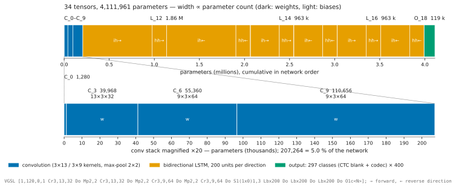
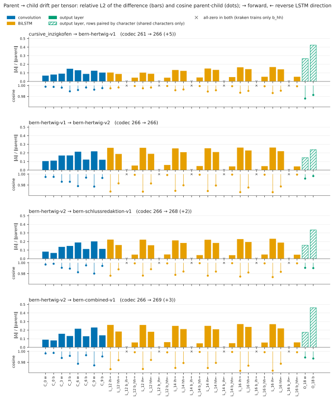
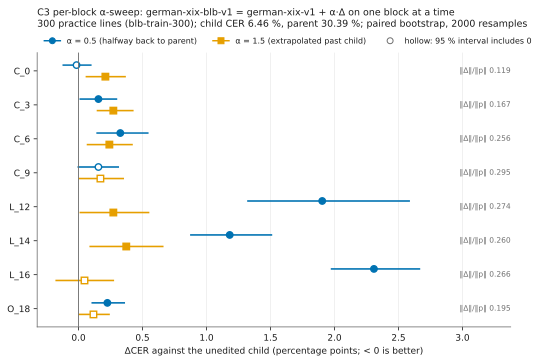
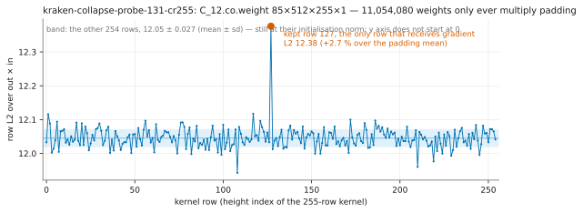

> **Status of this draft.** Sections 1 to 5 are complete in a first version. Sections 6 to 9 report what the project has measured by 7 November 2026 and mark what is still missing with `[TODO]`. Nothing in this draft is final. The list of open items is in `paper/STATUS.md`.

# Abstract

Automatic text recognition (ATR) has become routine infrastructure in the digital humanities, but the models it produces are usually handled as black boxes: a file and a character error rate. A recent blog post reports that a large language model can read the weights of a neural network, form hypotheses about what its parts do, and edit them in code without gradient descent [@takehi_sparks_2026]. We ask what this idea offers a humanities project that owns a family of text recognition models. We apply it to seven in-house models of the kraken engine, fine-tuned for sixteenth-century Bern chancery hands and nineteenth-century German Kurrent, in two steps. First we compare models by reading their weights across five lineage pairs. Second we let a language model propose and test weight edits under a protocol of preregistered hypotheses, a budget of forward passes on a practice set, paired bootstrap intervals and a single held-out evaluation.

Reading the weights shows consistent traces of fine-tuning: rows of rarely seen characters grow, and the bias of the CTC blank symbol rises in every fine-tune. The edits derived from these readings did not improve the models. Two preregistered sessions with a budget of ten passes each proposed fifteen edits; the three that were kept did not lower held-out error beyond noise. A per-block interpolation between parent and child shows that the gain of a fine-tune is held jointly by all blocks. A lossless rewrite that removes eleven million weights that never receive a gradient is the one edit that works as intended. The investigation also exposed two defects in our data: a dataset export that paired most training pages with the wrong images, and a held-out set of which half was a printed book with machine-read ground truth. We conclude that weight reading is cheap and informative about how fine-tuning moves a model, that it did not locate a repairable defect in any model we examined, and that its main practical value for a project lies in the protocol it forces: practice and held-out sets, preregistered predictions and intervals. `[TODO: update when the zoo-wide comparison and the adapter experiments are in.]`

# 1. Introduction

Automatic text recognition has moved, within a decade, from a specialist tool to a standard step in editorial and archival work. Platforms such as Transkribus [@muehlberger_transforming_2019] and eScriptorium [@kiessling_escriptorium_2019] put recognition engines in the hands of historians and philologists, the open engines kraken [@kiessling_kraken_2019; @kiessling_version_2025] and PyLaia [@puigcerver_pylaia_2018; @tarride_improving_2024] are widely used, and shared datasets and models are collected in catalogues such as HTR-United [@chaque_htr-unitedhtr-united_2021] and in large cross-century resources such as CATMuS [@clerice_catmus_2024]. A special issue of this journal took stock of the field for historical documents [@pinche_historical_2024], and the questions of provenance that follow from sharing training data and models have been discussed there as well [@romein_exploring_2024]. The consequences of the technology for scholarly practice have been described from several sides [@terras_inviting_2021; @hodel_konsequenzen_2018].

The technical core of most of these engines has been stable for even longer: a convolutional feature extractor, a stack of recurrent layers, and a connectionist temporal classification (CTC) output layer that lets the network emit characters without a segmentation of the line into letters [@graves_connectionist_2006; @graves_offline_2009; @puigcerver_are_2017]. A recognition model is therefore a small object. The in-house models studied here have about four million parameters and fit into a file of 16 megabytes.

In practice, however, such a model reaches a researcher as a file and a character error rate (CER). When a model performs worse than expected, or a fine-tuned child performs worse than its parent, the usual responses are to collect more ground truth and to retrain. Whether the model has a localisable defect, what exactly fine-tuning changed, and whether two models that share a parent differ in one place or everywhere are questions the usual workflow does not ask, because it has no way to ask them. An introduction for humanities readers describes the recogniser as something that learns to match pixel patterns to characters and to prefer likely sequences of characters [@schonhardt_automated_2026]. That description is a folk model. It is not something one can check against the weights.

This article tests how far the weights themselves can answer such questions, and whether a language model can help in reading them. It follows an idea from a recent blog post on weight-space programming [@takehi_sparks_2026]: a language model with access to a network's weights, a Python sandbox and a small budget of forward passes can hypothesise what parts of the network do, test the hypothesis, and edit the weights in code. We treat this as a way of looking inside, a "white box" counterpart to the black-box evaluation that dominates the field, and we apply it to a family of text recognition models for which we have the training history.

**Contributions.**

1. A protocol for weight-space sessions on text recognition models that makes every number traceable: practice and held-out sets with a documented overlap audit, hypotheses with predicted effect sizes written before the first forward pass, a keep rule based on paired bootstrap intervals, and the programmer's model identity (Section 3).
2. A reading of five lineage pairs of kraken models, aligned by character rather than by index, with a per-block interpolation as a controlled test of where a fine-tune's gain sits (Sections 6 and 7).
3. Two budgeted editing sessions and their held-out evaluations, both reported as no gain, with the predictions that failed (Sections 7 and 8).
4. A lossless rewrite that removes 11,054,080 weights from a kraken-based architecture that never receive a gradient (Section 7).
5. Two data defects found along the way, and the changes to the held-out sets that followed from them (Sections 6 and 7).

# 2. Text recognition models in practice

## 2.1 A growing variety of models

The variety of models in circulation has grown with the number of projects that train their own. The kraken project's repository of shared models held 48 models covering 18 writing systems when the fifth version of the engine was described [@kiessling_version_2025]. Transkribus publishes a list of public models [@readcoop_public_2021]. General models for specific scripts, such as German Kurrent, have been trained to serve many projects [@hodel_general_2021], and cross-century datasets are used to train models intended to generalise across hands [@clerice_catmus_2024]. Models built for one corpus are often reused as the starting point for another, so that families of fine-tunes arise: a medieval model is adapted to an early modern hand, and the result to a second project. Our own infrastructure illustrates this. The gateway that serves recognition models to our projects lists 42 third-party models from the Zenodo repository (among them CATMuS, TRIDIS, CREMMA, FoNDUE and OpenITI models) and seven models trained in-house.

The standard kraken setup is stable. Its default recogniser is a hybrid of a stack of four convolutional layers followed by three bidirectional LSTM layers of 200 units and a linear output layer, defined in a compact specification language and trained with CTC [@kiessling_version_2025]. All seven of our in-house models share one specification (Section 6.1). That uniformity is what makes it possible to compare their weights tensor by tensor.

## 2.2 The models of this study

The seven in-house models form two families (Table 1). Family 1 concerns the Bern Disputation of 1528: the Hertwig volume and the Schlussredaktion, written in early modern German chancery hands. It starts from a public medieval model, `cursive_inzigkofen`, itself a fine-tune of CATMuS Medieval, and has four members. Family 2 concerns the Kurrent hands of the Laßberg papers of the BLB (nineteenth century) and has two members, a general Kurrent model and a fine-tune on the project's own ground truth. `[TODO: spell out BLB, the holding institution and the archival signatures of the Bern volumes; confirm with the project.]` A third family of kraken+ models trained from scratch was part of the original plan and was dropped, because the training and validation data of the archived checkpoints were not preserved and the models could not be measured on their own material (Section 6.4).

| Model | Parent | Training data | Reported CER (trainer record) |
|---|---|---|---|
| `bern-hertwig-v1` | `cursive_inzigkofen` | Hertwig project, 1,786 lines | 0.271 (test), under-trained |
| `bern-hertwig-v2` | `cursive_inzigkofen` | same, higher learning rate | 0.233 (test) |
| `bern-schlussredaktion-v1` | `bern-hertwig-v2` | Schlussredaktion, 118 pages, 3,457 lines | 16.7 % (held-out) |
| `bern-combined-v1` | `bern-hertwig-v2` | both projects, 168 pages, 5,441 lines | 28.8 % (held-out), see Section 6.3 |
| `german-xix-v1` | to be confirmed | Kurrent corpora, 15,527 pages | 11.18 % (document-level held-out) |
| `german-xix-blb-v1` | `german-xix-v1` | four handwriting projects of the BLB ground truth | 8.7 % (held-out) |

: The in-house models. Reported values are from the trainer's own records and were not all measured on comparable sets (see Sections 6.3 and 7.5). {#tbl:models}

Every number that Sections 6 and 7 report as a result was measured again in this study, on sets whose composition is documented and audited.

# 3. Weight-space programming and our adaptation of it

## 3.1 The idea

The blog post that motivates this study reports that a general-purpose language model, given a network's weights, a Python sandbox in which it can read and save tensors but not run the network, and a budget of forward passes, can recover what a network was trained to do, repair a failing network and write small networks from scratch [@takehi_sparks_2026]. The post's headline example is a small language model whose accuracy on a mathematics benchmark rises from 7.9 to 48.1 percent after the agent identified a direction, written by the MLP blocks of two layers, that caused reasoning loops and subtracted it from 64 output columns in each of them, 0.016 percent of the weights. The authors call the approach weight-space programming and describe their results as very early. They also report a control in which the same procedure applied to a smaller model could not improve it, and conclude that "[e]diting weights could remove an obstacle that hid an ability, but it could not add an ability the model lacked". The networks in the post are multilayer perceptrons, small transformers and two language models. We found no report of the approach applied to a convolutional-recurrent network with a CTC output.

Three features of this idea matter for a humanities project. It treats the weights as a text that can be read, which promises a kind of transparency that evaluation on test sets cannot give. It treats the language model as an instrument with a budget, so that every forward pass it spends is accounted for. And it makes a falsifiable claim: if a model has an identifiable defect, reading should find it and a small edit should remove it.

## 3.2 Our adaptation

We follow the post's vocabulary but our implementation is more constrained. A session has one **subject** (a model with a digest), one **practice set** of a few hundred lines from the training side of the data, one **budget** of forward passes (ten in the sessions reported here), and one **held-out set** that the programmer never sees. The loop is:

1. The weights are loaded into a sandbox without network access, optimiser or training data. The programmer (a language model running in Claude Code) has read summaries of the weights produced by our code and the practice set.
2. Before the first pass, the programmer writes a preregistration: for each hypothesis, a predicted direction and size of the change in CER on the practice set, and the edit class that would test it.
3. The programmer writes the whole program in advance. The sandbox then runs it unattended. This differs from the interactive loop of the post, in which the agent interleaves edits and passes. We chose it so that predictions are fixed before any measurement; the cost is that the programmer cannot react to a result within a session.
4. After each edit a pass over the practice set measures CER, word error rate, the number of collapsed lines and the confusion pairs. The harness keeps an edit only if the paired bootstrap 95 percent interval of the CER difference against the last kept state lies entirely below zero. Unspent passes stay unspent.
5. At the end the session is frozen. The held-out set is scored once. A difference whose interval includes zero is reported as no gain.

The programmers were Claude Fable 5.1 (`claude-fable-5-1`) for the first session and Claude Opus 5.5 (`claude-opus-5-5`) for the second, both in Claude Code on the project's research server. The weight readings that supply the hypotheses were produced from tables of per-tensor statistics, not from raw tensors in the model's context. The sessions ran on CPU: a pass over 300 lines took about 20 seconds with 12 threads.

Control conditions are defined for each model family: a no-op round trip, the parent model, a uniform average of siblings, a per-block interpolation between parent and child, a short retraining on the same data, a sham edit of the same size, and a blind programmer without forward passes. Only the round trip, the parent and the interpolation have been run; the others are listed as open work in Section 10.

# 4. Research questions

The study began as a comparison of models and became an investigation of adaptation. We ask three questions.

**RQ1 (reading).** What do the weights of related text recognition models tell about how fine-tuning changed them? Specifically: where do parent and child differ, are those differences consistent across fine-tunes, and do they agree with the models' behaviour on the same lines?

**RQ2 (adaptation).** Can a language model that reads the weights propose edits, under a small budget of forward passes, that improve a recognition model on held-out data, or undo a defect, more cheaply or better than the obvious alternatives such as interpolating towards the parent?

**RQ3 (combination).** Do the readings predict which edits work? That is, does what weights show about a model's history carry information about what can be done to it?

We registered one expectation before any measurement. The post's own evidence suggests that gains come from removing an identifiable obstacle and not from adding ability, so on a healthy fine-tune we expected at most a point or two of CER, and a larger gain only where a model carries a defect that reading can find: a collapse in CTC output, a dead or skewed output row, a layer wrecked by a fine-tune. A negative result, with the infrastructure still useful, was named as a risk in the plan.

# 5. Related work: explaining and editing text recognition networks

We searched for earlier work on analysing, explaining and editing neural networks for text recognition, across arXiv, the ACL Anthology, dblp, Crossref, HAL, Zenodo and, partially, OpenAlex; 72 papers were examined individually, 58 from open full text. The protocol, the query log and the coverage gaps are documented in the repository (`docs/SEARCH_LOG.md`, `docs/RELATED_WORK.md`). IEEE Xplore, Google Scholar, Scopus and Semantic Scholar could not be searched, so statements of absence below are bounded by this search.

## 5.1 Explanations for text recognition exist, but are narrow

Explainability studies for text recognition are few and each covers a narrow case. For CTC recognisers, integrated gradients have been applied to a page-level model [@yousef_origaminet_2020], a built-in association map has been proposed for a vision transformer with a CTC head [@buoy_explainable_2023], and per-character attribution has been compared across six scene-text models [@ty_scene_2023]. For handwriting, attention maps are shown for paragraph and line models [@coquenet_towards_2022; @hamdan_htr-jand_2024]. The validation of these explanations is thin. Maps are mostly judged by eye, one study uses a single metric both to choose and to compare methods, and only one study of handwriting-related networks tests a saliency map against a random order, finding on one backbone scores below chance [@pundy_transparency_2025]. We found no survey of explainability for text recognition.

## 5.2 How earlier work assessed what a network does with text

Most work assesses behaviour from the outside. Five kinds of assessment recur.

1. **Input manipulation with an exact ground truth.** The closest study to ours in object trains a recurrent CTC line recogniser on synthetic English text and probes it with shuffled characters and with seen and unseen character sequences; it finds that the network uses about five characters of context [@sabir_implicit_2017]. More recent studies of vision-language models render perturbed or random text and score against the perturbed string [@karamolegkou_reading_2026; @liang_visual_2026]. The former includes kraken as a black-box baseline and finds that it is affected much less than the vision-language models by character-level scrambling, without examining its weights.
2. **Swapping decoders or modules.** External language models fused at decoding time still lower the error of recurrent CTC networks, which shows that the recurrent layers do not saturate the language signal but cannot show what they encode [@tarride_revisiting_2024; @moysset_are_2018]. Removing the recurrent layers and retraining raises error considerably [@coquenet_have_2019].
3. **Attribution and attention maps**, as in Section 5.1.
4. **Mechanistic analysis of heads, neurons and hidden states**, which exists only for transformer-based vision-language models [@baek_how_2025; @huangfu_retrieval_2026].
5. **Context and structure of CTC itself**, where the output of a CTC network has been shown to consist mostly of blank frames with brief label spikes [@zeyer_why_2021; @jung_blank_2023], and where spike positions can be systematically offset from the true position of a token [@zeyer_gradient-based_2026].

None of these studies intervenes on the recurrent layers of a trained CTC recogniser, and in kraken's literature the engine appears as a baseline, in training experiments on image pre-processing [@jacsont_impact_2023] and in a description of its architecture [@kiessling_version_2025].

## 5.3 Editing weights

In language models, differences between weights have been treated as editable objects: task vectors [@ilharco_editing_2022], averages of fine-tuned models [@wortsman_model_2022], merges that resolve interference [@yadav_ties-merging_2023], located factual associations [@meng_locating_2022], and a single direction that mediates refusal [@arditi_refusal_2024]. For text recognition we found four related operations: averaging task vectors of fine-tuned word recognisers with a CTC loss and then fine-tuning on a new script [@molina_rodriguez_ocr_2025], zeroing neurons selected by activation contrast and then fine-tuning in order to unlearn writer identity in a transformer recogniser [@kang_preserving_2026], freezing prefixes of layers during fine-tuning [@sharma_trocr_2026], and an SVD of the output matrix of an LSTM for digits, which we could read only in abstract [@zervakis_multivariate_2019]. All judge their result by accuracy or by a privacy test, not by what the edit does to the network's handling of text.

## 5.4 What is new here

In this search we found no earlier work that treats a trained CTC line recogniser as an object to be read and edited in weight space, with edits proposed from a reading of the weights under a forward-pass budget and checked on a held-out set. Weight-level operations on text recognisers exist, as the previous section shows, so the claim is narrow, and we state it as such. A further finding of the search matters for what follows: the closest published evidence on the architecture we study is behavioural, and it points to an "implicit language model" in the recurrent layers that has been inferred from accuracy gaps and never probed directly.

# 6. Comparing models by reading their weights

## 6.1 Material and method

All seven in-house models share one architecture, written in kraken's specification language as a stack of four convolutional layers with pooling and dropout, a collapse of the height axis, three bidirectional LSTM layers of 200 units and a linear output layer over the model's character codec. The models have 4.11 million parameters in 34 tensors. The output layer is a matrix with one row per codec entry and 400 columns. In every LSTM layer kraken stores an all-zero input bias, so those tensors cannot differ between models.

For each parent and child we computed, per tensor, the relative L2 distance between child and parent and the cosine between them. For the output layer we aligned rows by character and not by index, because every fine-tune had grown its codec: the number of output rows differs between parent and child, and an index-wise comparison would silently compare different characters. No forward pass is needed for this reading. The behaviour of the models on the same lines, in the form of character error rates and confusion pairs, was measured separately on practice sets of 300 lines taken from the training side of the data (Section 7.1).

{#fig:arch}

## 6.2 Behaviour on the practice sets

Table 2 gives the character error rate of each model on 300 lines of its own training side. These numbers are not results in the sense of generalisation: fine-tuned models read their own training lines better than any others. They are the baselines against which edits are measured, and the parents' numbers on the same lines show how far fine-tuning moved each model.

| Practice set | Model | CER | Collapsed lines |
|---|---|---:|---:|
| Hertwig lines (300) | `cursive_inzigkofen` (parent) | 0.706 | 23 |
| | `bern-hertwig-v1` | 0.177 | 19 |
| | `bern-hertwig-v2` | 0.083 | 12 |
| | `bern-schlussredaktion-v1` | 0.214 | 17 |
| | `bern-combined-v1` | 0.185 | 26 |
| BLB lines (300) | `german-xix-v1` (parent) | 0.304 | 23 |
| | `german-xix-blb-v1` | 0.065 | 10 |

: Character error rates on practice sets (training side of the data). Collapsed lines by the legacy definition used when the numbers were produced. {#tbl:practice}

The most frequent confusion in every model is a deletion: the space, `e` and `n` are replaced by nothing. This is the pairing that the readings use.

## 6.3 What the weights show

Three observations hold across all five lineage pairs (Table 3).

| Pair | Codec rows (parent → child) | Output rows, mean relative change | Blank bias change | Largest block change |
|---|---|---:|---:|---|
| `cursive_inzigkofen` → `hertwig-v1` | 261 → 266 | 0.26 | +0.06 | all blocks 0.06 to 0.12 |
| `hertwig-v1` → `hertwig-v2` | same | 0.19 | +0.002 | uniform, 0.10 to 0.17 |
| `hertwig-v2` → `combined-v1` | 266 → 269 | 0.19 | +0.118 | LSTM 0.12 to 0.14 (max 0.27) |
| `hertwig-v2` → `schlussredaktion-v1` | 266 → 268 | 0.17 | +0.056 | conv 0.07 to 0.16 |
| `german-xix-v1` → `xix-blb-v1` | 224 → 296 | 0.19 | +0.113 | second conv bias, relative change 1.09 |

: Lineage readings (relative L2 of child minus parent per block; output rows aligned by character). Pair `hertwig-v1` → `hertwig-v2` are two runs on the same data and parent with different learning rates, not a parent-child fine-tune. {#tbl:lineage}

First, **fine-tuning inflates the rows of rarely seen characters.** In every pair the output rows that moved most belong to characters the child saw rarely or never (umlauts, the long s, abbreviation signs, combining marks). Their norms grew by 30 to 110 percent and their biases fell by 0.2 to 1.0, in one direction. This is what CTC training does to a class that only ever receives a negative gradient: its row is pushed away from every input it meets. The frequent letters have the smallest norms in every model (4 to 5 against a mean of 11 to 15) and barely move.

Second, **the bias of the blank symbol rises in every fine-tune.** Together with the dominance of deletions in every confusion table, this made a change of the blank bias the first cheap hypothesis for every target.

Third, **the convolutional stack moves less than the recurrent stack and the output layer**, with one exception: the first convolutional block, which hardly moves at all (relative change 0.07 to 0.13) and seems to hold generic stroke detectors. For the German Kurrent pair the second convolutional bias moved most (relative change 1.09), and the deeper convolutions moved by 0.26 to 0.33; the Kurrent fine-tune re-tuned the feature extractor, whereas the Bern fine-tunes moved the recurrent stack and the classifier instead.

{#fig:drift-bern}

{#fig:drift-xix}

{#fig:rows-xix}

The pair `hertwig-v1` → `hertwig-v2` shows what a healthy continuation looks like: no tensor or row stands out, the largest moves are 0.17 to 0.33 with cosines of at least 0.97, and the improvement on the practice set (CER 0.177 to 0.083) is spread over the whole network. Nothing in this pair points to a localised edit that would turn the first model into the second.

## 6.4 The case of `combined-v1`, and what turned out to be a data defect

The plan chose the pair `hertwig-v2` → `combined-v1` as its first target, because the trainer's records gave the child a held-out CER of 28.8 percent against 16.7 percent for its relatives. The weights of the child showed the largest blank-bias shift of the family (+0.118), and its rarest rows had grown by 40 to 100 percent with biases down by 0.6 to 1.0. That profile, we reasoned, is what a model learns from label noise. When we tried to measure the model, we found that this was literal. Every model of the family read the Hertwig practice lines with a CER of 0.76 to 0.86, and kraken's own test command gave 14 percent character accuracy for `hertwig-v2` on one of its own training pages. After ruling out the environment, the line cutting and the model file, we compared two exports of the Hertwig dataset on the Hugging Face hub. The export of 25 October 2026 had identical page XML on all 50 training pages, but the images of 44 of the 50 pages differed from the export of 22 October: most training pages were paired with the image of another page. `bern-combined-v1` had been trained from the 25 October export, started 35 seconds after the push, and the trainer records no dataset revision. On the 22 October export, `hertwig-v2` reads one page at 96.8 percent character accuracy against 14.3 percent on the later one, and its CER on the practice lines is 0.083 against 0.757.

The finding changed the premise of the target. The 28.8 percent figure came from numbers scored on mismatched pages or on different sets. On correctly paired held-out pages `combined-v1` is the best of the three family members overall (CER 0.193, against 0.275 for its parent and 0.204 for its clean sibling), and the label noise cost it about three points on the Hertwig hand. The dataset was repaired by hand on 6 November 2026 by restoring the byte-identical files of the earlier export. The weight profile of the model is consistent with label noise, but we have not tested whether it would have identified label noise without the independent evidence, and we do not claim that it does.

## 6.5 A comparison across a model zoo

`[TODO: not yet done. The readings above cover seven models of one project. The gateway serves 42 third-party kraken models from Zenodo, and the kraken repository lists 48 models in 18 writing systems. A read-only survey of their weights (architecture strings, parameter counts, codec sizes, output-row statistics, blank bias, pairwise distance between models that share a parent) needs no forward pass and could ask whether the three observations of Section 6.3 are properties of kraken fine-tuning in general. A brief for this survey is in docs/BRIEF_ZOO_SURVEY.md.]`

# 7. Can weights be edited? Controls, sessions, and what we had to correct

## 7.1 Protocol and sets

A session needs two kinds of data that must not overlap. The **practice set** is seen by the programmer; the **held-out set** is scored once after the session is frozen. Practice sets are 300 lines cut from the training side of the data. The held-out sets are built from the object-level evaluation projects of the data and are audited against every practice list and against the corpora the subject was trained on; a set that shares a document with the training data is labelled as not held-out. The overlap audit also had to be corrected once, because the share spelled shelfmarks as `K2911,14` where the export spelled them `K2911-14`; under one spelling the sets were still clean.

For every reported difference we compute a paired per-line bootstrap interval (2,000 resamples, a fixed seed). The keep rule was tightened after the first session, as described below. All sessions are reported, including edits that were reverted, and the ratio of kept to attempted edits is a result in its own right.

## 7.2 A control: where does a fine-tune's gain sit?

Before any edit we measured where the gain of the Kurrent fine-tune lies. For each of eight blocks (four convolutional, three LSTM, the output layer) in turn, we set the block to `parent + α (child − parent)`, leaving all other blocks as in the child, and scored the practice set (Table 4). For the output layer the 225 shared rows were interpolated and the 72 rows that only the child has were kept as they are. The child reads the practice set with a CER of 0.0646 and the parent with 0.3039, a gap of about 24 points. The held-out set was not touched.

| Block | Relative change child − parent | Δ CER at α = 0.5 (points) | Δ CER at α = 1.5 (points) |
|---|---:|---|---|
| first conv | 0.119 | −0.02 [−0.13, +0.10] | +0.21 [+0.06, +0.37] |
| second conv | 0.167 | +0.16 [+0.01, +0.30] | +0.27 [+0.14, +0.43] |
| third conv | 0.256 | +0.33 [+0.14, +0.55] | +0.24 [+0.06, +0.42] |
| fourth conv | 0.295 | +0.16 [−0.01, +0.32] | +0.17 [+0.00, +0.36] |
| LSTM 1 | 0.274 | +1.90 [+1.32, +2.59] | +0.27 [+0.01, +0.55] |
| LSTM 2 | 0.260 | +1.18 [+0.87, +1.51] | +0.37 [+0.09, +0.66] |
| LSTM 3 | 0.266 | +2.31 [+1.97, +2.67] | +0.05 [−0.18, +0.28] |
| output layer | 0.195 | +0.23 [+0.10, +0.36] | +0.12 [+0.00, +0.25] |

: Per-block interpolation between parent (`german-xix-v1`) and child (`german-xix-blb-v1`), practice set of 300 lines; difference against the unedited child with paired bootstrap 95 % intervals in brackets. {#tbl:alpha}

{#fig:alpha}

Three things follow. The gain is not in any one block: halving the move of a single block costs at most 2.3 points, and the eight halvings together add up to about 6 points against a gap of 24. The gain is held jointly, each block depending on the others having moved with it. This is the profile of a healthy fine-tune, not of a localised repair. Second, among the blocks, the recurrent stack holds what can be localised: halving the last LSTM block leaves the letters intact but loses word boundaries (deleted spaces rise from 103 to 263, word error rate from 0.171 to 0.319), so the last recurrent layer is where this model learnt Kurrent spacing. Third, a large relative change does not mean a large functional change: the second convolutional bias, the tensor that moved most in the reading, is worth 0.16 points when halved. Only the last LSTM block tolerates extrapolation to α = 1.5.

## 7.3 Session 1: the Kurrent production model

The first budgeted session used `german-xix-blb-v1` as subject, the BLB practice set of 300 lines and a budget of ten passes. The programmer registered eight hypotheses from the readings, each with a predicted size (Table 5). All concerned the output layer, because the readings had pointed there: the blank bias, the space row, the twelve rows that moved most, and the rows of the frequent letters. The session ran under the keep rule of the time: an edit is kept if practice CER falls and the number of collapsed lines does not rise. It used eight passes, proposed seven edits, kept two and changed one element of one tensor (the blank bias, 1.2323 to 0.2323). Practice CER went from 0.06458 to 0.06435, a difference of −0.023 points with an interval of [−0.34, +0.30].

| Hypothesis | Edit | Predicted ΔCER (points) | Measured practice CER (Δ vs. unedited, points) | Decision |
|---|---|---|---|---|
| H1 blank bias back to parent value (−0.113) | add to bias | −0.1 to −0.5 | 0.06443 (−0.016) | kept |
| H2 blank bias −0.5 total | add | a further −0.3 to −1.0 | 0.06505 (+0.047) | reverted |
| H3 space bias +1.0 | add | −0.2 to −0.6 | 0.06474 (+0.016) | reverted |
| H4 space bias +0.5 | add | −0.1 to −0.3, or a rise | 0.06489 (+0.031) | reverted |
| H5 twelve most-moved rows from parent | set rows | \|Δ\| < 0.05 (null) | 0.06458 (0.000) | reverted (tie) |
| H6 frequent letters' rows × 1.1 | set rows | −0.2 to −0.5 | 0.06505 (+0.047) | reverted |
| H7 blank bias −1.0 total | add | as the step above | 0.06435 (−0.023) | kept |

: Session 1 (`german-xix-blb-v1`, 300 practice lines). Predictions were written before the first pass. {#tbl:s1}

Every output-layer lever traded deletions for insertions and substitutions roughly one for one. Lowering the blank bias reduced the deletion of spaces from 103 to 90 and of `e` from 40 to 35, and the error rate rose. Raising the space bias did the same, and the insertions it produced ate the gain. Scaling the frequent rows reduced the deletions of `e` and `n` as predicted and increased substitutions among those letters by more. Only the null prediction, that the twelve typographic rows are inert, was right. The programmer left two passes unspent, because every lever had been measured at two sizes and a third would have fitted the practice set.

**Held-out, once.** The frozen model was scored on all 5,628 lines of the handwriting evaluation projects (Table 6). The CER before and after was 12.335 and 12.325 percent, a difference of −0.010 points with an interval of [−0.048, +0.026], and the interval contains zero on every one of the four projects. The edit is not a gain.

| Held-out set | Lines | CER before (%) | CER after (%) | Δ (points) [95 % interval] |
|---|---:|---:|---:|---|
| all four projects | 5,628 | 12.335 | 12.325 | −0.010 [−0.048, +0.026] |
| `lassberg_eval` | 446 | 5.27 | 5.32 | +0.050 [−0.037, +0.139] |
| `korrespondenten_eval` | 452 | 24.43 | 24.42 | −0.011 [−0.157, +0.131] |
| `unbestimmt_eval` | 193 | 14.72 | 14.64 | −0.083 [−0.336, +0.162] |
| `manuskripte_eval` | 4,537 | 11.75 | 11.73 | −0.013 [−0.051, +0.027] |

: Session 1, held-out evaluation after freezing (the parent model reads the full set with 31.96 % CER). {#tbl:s1heldout}

The first session's keep rule was then replaced by the rule now in the protocol, which requires the interval against the last kept state to exclude zero; under it this session would have kept nothing.

## 7.4 Session 2: undoing label noise

The second session targeted `bern-combined-v1`, with the practice set of 300 lines drawn from both of its training projects, the correct images of the 22 October export (103 Hertwig lines, 197 Schlussredaktion lines), and a held-out set of 545 lines from the test pages of the two projects. The question was whether a weight edit can undo training on label noise, with its parent and its clean sibling as donors. Eight hypotheses were registered: the blank bias back to the parent's value, each of the output layer, the three LSTM layers and the whole convolutional stack transplanted from the sibling, the output layer transplanted from the parent, and the last LSTM layer interpolated halfway towards the parent (Table 7).

| Hypothesis | Predicted | Measured (practice, all / Hertwig / Schlussredaktion) | Decision |
|---|---|---|---|
| H1 blank bias to parent | −0.2 to +0.2 | 0.1451 / 0.204 / 0.118 | refused (interval contains 0) |
| H2 output layer from sibling | refused | 0.1458 / 0.204 / 0.119 | refused |
| H3 LSTM 3 from sibling | refused | 0.1505 / 0.213 / 0.122 | refused (CER rose) |
| H4 LSTM 2 from sibling | refused | 0.1514 / 0.212 / 0.123 | reverted (collapsed lines rose) |
| H5 LSTM 1 from sibling | refused | 0.1449 / 0.197 / 0.121 | refused (interval contains 0) |
| H6 conv stack from sibling | refused | 0.1508 / 0.212 / 0.123 | reverted (collapsed lines rose) |
| H7 output layer from parent | net worse | **0.1414** / 0.190 / 0.119 | **kept** (interval [−0.85, −0.04]) |
| H8 LSTM 3 halfway to parent | within [−0.5, +1.0] | 0.1427 / 0.172 / 0.129 | refused |

: Session 2 (`bern-combined-v1`); unedited practice CER 0.1456 (Hertwig 0.205, Schlussredaktion 0.118). {#tbl:s2}

One edit was kept: the output layer of the parent, whose 266 shared character rows were transplanted and whose three new rows were retained. Its practice gain of 0.42 points came from the 103 Hertwig lines, which are the parent's own training lines; the parent's output layer fits them, so a transplant from it looks good on practice and does not transfer. On the held-out set the edit changes the CER from 19.33 to 19.48 percent (+0.15 points, interval [−0.10, +0.42]). It trades a non-significant gain on Hertwig for a significant loss on Schlussredaktion (Table 8). The edit is not a gain.

| Held-out set | Lines | CER before (%) | CER after (%) | Δ (points) [95 % interval] |
|---|---:|---:|---:|---|
| all | 545 | 19.33 | 19.48 | +0.15 [−0.10, +0.42] |
| Hertwig | 287 | 26.69 | 26.39 | −0.30 [−0.72, +0.13] |
| Schlussredaktion | 258 | 13.48 | 13.99 | +0.51 [+0.21, +0.82] |

: Session 2, held-out evaluation after freezing (parent 27.49 %, clean sibling 20.36 % on the full set). {#tbl:s2heldout}

The session also shows a weakness in the protocol, which we have corrected for the future: a donor that was trained on the practice lines biases the keep rule, because the transplant is measured on lines the donor has memorised. The programmer's own check and report also misread one decision because the harness returned no value for it, a bug that we fixed the same day, recorded as a deviation in the session's summary; the harness decided every edit correctly.

## 7.5 A rewrite that works: removing weights that never learn

One edit is not a gain in accuracy and works exactly as intended. A kraken-based architecture that we had used in an earlier project ends in a convolution with a kernel of 255 rows applied to a feature map of a single row. Of those 255 kernel rows only the central one ever sees data; the other 254 multiply padding and never receive a gradient. They account for 11,054,080 of the 15,207,871 parameters of the model. The rewrite keeps the central row, rebuilds the model with a kernel of one row, and copies every other tensor unchanged. The result reads the same 300 lines with identical text, the largest difference between the output probabilities is 1.1 × 10⁻⁶ (rounding in single precision), and the new file loads through the serving engine. The padding rows of the checkpoint sit at their initialisation norm (12.045 ± 0.027 against 12.38 for the live row), as weights that never receive a gradient must. The model file shrinks from 61 to 17 megabytes. The only checkpoint of this architecture still available was a collapsed training run, so the equality of outputs demonstrates the rewrite and not the quality of a recogniser. The archived models of the same project already used the smaller layer, so the rewrite is not needed for anything that is served.

{#fig:padding}

## 7.6 The collapsed lines are a data question

After the first session, 428 of the 5,628 held-out lines were "collapsed" for `german-xix-blb-v1`: the hypothesis was less than half or more than twice the length of the reference, or a character trigram repeated six times. These lines carried 40 percent of the held-out errors, so a defect there would have been worth repairing. We classified every one of them. None was a readable handwritten line that the model gets wrong while its parent reads it. The classes were broken boxes (111 lines whose box is one to seven pixels high, all in one volume), vertical lines of envelopes and marginal notes (100), correct text flagged by the trigram test (142; on ordinary text, punctuation and endings repeat that often), short lines on which every model fails, mostly references that are optical character recognition (OCR) junk or garbled headings (36), references of one to three characters (30), and boxes holding more than their text (9).

The volume with the broken boxes is the printed *Regesten des Stiftes Kreuzlingen* of 1853, filed with the manuscripts, whose references are the library's own OCR of the print. Its 2,825 lines are half of the held-out set. When the boxes were re-cut to the page's median line height, centred on the original box, the 115 broken-box lines of the re-cut set read with a CER of 0.35 instead of 1.0; rotated by 90 degrees, the vertical lines read with 0.34. The model read the print well where the box was right. With the 221 degenerate, vertical and upside-down lines re-cut, the held-out CER of `german-xix-blb-v1` is 9.55 percent; with the 286 data-defect lines (all classes except the false positives) left out it is 8.07 percent; the 12.34 percent of the first measurement and the trainer's own 8.7 percent are explained by the differences. The gap to the parent model does not depend on any of this (31.96 against 12.34 percent as cut, 29.38 against 8.07 percent with defects left out).

The consequences were practical. The collapse test was corrected so that a repetition counts only when it is at least twice as frequent as in the reference (the old test remains available, and every earlier count is recorded under both). A new held-out set, `blb-eval-hand`, keeps the handwriting part of the evaluation projects by data properties alone, because choosing test lines by how a model reads them would bias every number measured on them: it excludes the printed book, a typescript, a printed form, a page of music, a folded letter's address side, vertical lines, lines of one to three characters and boxes holding two lines. It has 2,272 lines in 29 objects. On it `german-xix-blb-v1` reads with a CER of 9.55 percent and its parent with 23.86 percent; the frozen artefact of session 1, re-aggregated on it, reads 9.553 percent before and after, a difference of −0.001 points with an interval of [−0.055, +0.053]. A re-aggregation of one reading is not a second evaluation, and the conclusion is unchanged.

For family 1 the same classification of the held-out set found 34 flagged lines, of which 21 are mostly mismatches between the polygon and the text in the Transkribus ground truth, and only 7 are lines that `hertwig-v2` reads and `combined-v1` drops. These 7 lines are 2.2 percent of the errors, too few to carry a paired interval. No session on collapsed lines is proposed for either family, because such a session would be a session on data defects.

# 8. The two parts combined: do the readings predict what editing can do?

## 8.1 Predictions against measurements

Both sessions registered predicted effects before the first forward pass, so the readings can be tested as a source of hypotheses. In Session 1, six hypotheses predicted a gain of between 0.1 and 1.0 points (Table 5). None reached the lower end of its predicted range. The measured differences against the unedited model were −0.016, +0.047, +0.016, +0.031, +0.047 and −0.023 points, so two had the predicted sign and both were within the noise of the practice set. The one hypothesis that predicted a null, that the twelve typographic rows are inert, was correct. The readings were right about the direction of every lever, in the sense that each one reduced the deletions it targeted, and wrong about the size: for the blank bias the readings predicted a change of CER of −0.5 to −1 points, and the measured change was −0.02 points on practice and −0.01 on the held-out set.

In Session 2 all eight hypotheses were registered as likely to be refused, and seven decisions were predicted correctly (Table 7). The predicted magnitudes were mixed. The sibling's output layer was predicted to worsen the Hertwig lines by one to three points and left them within 0.1 points; the sibling's first LSTM layer was predicted to worsen them and improved them by 0.8 points; the output layer from the parent was predicted to make the model worse on the whole and improved the practice set. The second session was written after the first, by a different model, with the first session's report at hand. We cannot say whether its better calibration reflects the model, the experience or the nature of the target.

## 8.2 Why edits at the output layer cannot do what the readings suggested

Reading showed a consistent pattern in the output layer, and the pattern is real: the blank row's bias does rise in every fine-tune, and deletions dominate every confusion table. The pattern is not causal in the way the hypothesis assumed. Every output-layer lever traded deletions for insertions and substitutions roughly one for one, so the model's deletions are not decided by the bias of a row. The per-block interpolation points to where they are decided: the gain of the fine-tune is held jointly, the recurrent stack holds what can be localised, and the last LSTM block carries the spacing. In a CTC model each frame is decided by the recurrent stack on the basis of its context; a bias reading of the output layer cannot see that the margins at the deleted frames are large.

## 8.3 Reading and defects

The expectation we registered was that gains come from removing a defect that reading can find. In family 1 a defect existed: the model had been trained on mismatched pages. Reading did not find it. A failing test of kraken's own command on a training page did, and the weight profile fitted the story only afterwards. In family 2 reading found no defect, and the 428 collapsed lines that looked like one were data defects of the held-out set. In the kraken+ architecture there is a defect that reading can find, because it is a property of the architecture and not of a training history, and the rewrite repairs it exactly. The three results fit the expectation and do not support the stronger claim that weight reading will identify a defect in a trained recogniser.

## 8.4 Summary by research question

**RQ1.** Reading weights across lineage pairs is cheap, needs no forward pass, and shows consistent traces of fine-tuning (Section 6.3). The traces agree with the confusion tables in direction. They do not localise the gain of a fine-tune.

**RQ2.** Under a budget of ten passes and a keep rule based on paired intervals, no edit that a language model proposed improved a model on held-out data: seven edits in Session 1 (two kept), eight in Session 2 (one kept), with held-out differences of −0.010 and +0.15 points and intervals that contain zero. The three controls that have been run (round trip, parent, interpolation) agree. The controls that would say whether a cheaper alternative does better have not been run.

**RQ3.** The readings predicted direction and not size, and the sizes they predicted were one to two orders of magnitude too large. The readings were nonetheless useful in two ways that were not predicted: they came with a measurement plan, baselines on audited sets, that made a data defect visible, and they showed that an apparent defect in a model, the collapse of 428 lines, was not in the model.

# 9. What we learned about the inner workings of the networks

## 9.1 About the text recognition models

1. **Fine-tuning leaves a legible but mostly cosmetic trace in the output layer.** Rows of rare characters inflate and the blank bias rises. Moving them back changes little, because the errors are decided upstream.
2. **A fine-tune's gain is held jointly.** Halving the move of one block costs up to 2.3 points, and the eight halvings add up to about a quarter of the gain. Gains are therefore not additive across blocks, and interactions dominate.
3. **The recurrent stack holds the localisable part, and the last recurrent layer holds word spacing.** This is a finding about one model and it is compatible with the behavioural literature on recurrent CTC recognisers, in which recurrent layers contribute context and are not replaced by an external language model [@sabir_implicit_2017; @tarride_revisiting_2024]. We did not test it directly on the recurrent state, and the claim that recurrent layers hold an "implicit language model" is therefore still inferred from behaviour.
4. **A large relative change in a tensor is not a large change in function.** The second convolutional bias had the largest relative change of the Kurrent pair and is worth 0.16 points.
5. **Some weights never learn.** In an architecture whose last convolution runs over a feature map of one row, 99.6 percent of that layer's kernel rows (254 of 255) never receive a gradient. They can be removed without changing any output.
6. **Training on label noise leaves a profile in the weights that is not a repair target.** A model trained on mostly wrong labels differs from its parent in the blank bias and in rare rows, but no donor block improves it, and it remained the best family member overall.

## 9.2 About a language model as reader and editor

The language model in our sessions is an instrument, and we can report what it did well and what it did not do.

- It formulated hypotheses from tables of weight statistics that were plausible, specific and falsifiable, with predicted directions that were mostly right.
- Its predicted sizes were too large in the first session by a wide margin, and the first session's results are a caution against reading a bias as a lever.
- It found no defect that could be repaired, so the positive scenario of the blog post is not tested here, neither confirmed nor refuted. The post's own caveat, that editing can remove an obstacle but not add an ability, fits the three results.
- The constraints did the work that would otherwise have been left to judgement. Preregistration made the failed predictions visible, the paired interval turned two apparent gains in the first session into noise, and the practice-and-held-out split exposed the donor effect in the second.
- Mistakes were at least as likely to be in the surrounding code and data as in the model's reasoning: a harness that returned no value for one decision, a difference in the spelling of shelfmarks between two sources that could have hidden overlaps from the first audit, and a held-out set that was half a printed book.

## 9.3 What this study does not tell about language models

The only language model in these experiments is the programmer. We studied the internals of text recognition networks, not of language models, and nothing here supports a statement about how language models represent or process text. The extension that would is the one in the plan: sessions on low-rank adapters of vision-language models fine-tuned for page transcription, where the weight change of a module is a product of two small matrices whose directions can be enumerated, and where the defects of interest, such as repetition loops and truncated output on long pages, are recorded by the trainer. `[TODO: the adapter track has not been run. If it is run before submission, this section should report its protocol and results; if not, the section should be limited to this statement of scope.]`

# 10. Discussion and limits

**What a project can take from this.** Reading the weights of related models is cheap enough to do routinely and informative about how a fine-tune moved a model. We do not recommend editing weights to improve a recogniser; retraining with more or cleaner data is the better-controlled route. The practices that the protocol forced, however, are directly useful for any project that trains models: pin the revision of the data a model was trained on and record it; build held-out sets by data properties and audit them against the training data; look at the lines with the highest error before touching the model, because they are often data; report the number of lines on which a model collapses together with a definition; and give an interval with every difference.

**Limits.** The study rests on two sessions with two programmers, a budget of ten passes, practice sets of 300 lines and one run per condition. The programs were written before the sandbox ran and could not react to results. Several controls that the protocol defines have not been run: the uniform average of siblings, a short retraining on corrected data, a sham edit of the same size and a programmer without passes. The readings were made from tables of statistics and not from raw tensors, so they do not test whether a model reading raw weights would do better. The held-out sets contained defects that we found only after the first session, and the correction was made on the basis of the same results; the conclusion for Session 1 does not depend on it. The Bern data and the Kurrent ground truth are two corpora of two hands, so generalisation to other scripts or engines is untested. The models are small. We cannot say whether the same would hold for larger recognisers.

# 11. Conclusion

We asked what a language model that reads weights can offer a project with a family of text recognition models. Reading across five lineage pairs showed consistent traces of fine-tuning but not a repairable defect. Fifteen proposed edits in two preregistered sessions produced no improvement on held-out data, and a controlled interpolation showed that a fine-tune's gain is held jointly by all blocks. A lossless rewrite removed eleven million weights that never receive a gradient. The attempt to repair models led us to two defects in our data, the mismatched images of a dataset export and a printed book in a handwriting held-out set, and to better held-out sets. The result is a negative one for weight editing as a way of improving recognisers, and a positive one for the discipline of preregistered, interval-checked, held-out evaluation. Whether language models can do more with weights than our recognisers allowed, in particular with the adapters of the vision-language models that increasingly replace them, remains the open question.

# Declarations

**Data and code availability.** The code of the harness, the protocol, the run folders (preregistration, log, notes, sparse weight difference, summary) and the baselines are in the repository `thodel/weightspace`. `[TODO: the repository is private; before submission it must be made public or archived (for example on Zenodo) with a licence, and the access conditions for each data set stated.]` The model weights are on the project's research storage and are not in the repository; the sparse differences are. The Bern Disputation data are held in the project's dataset `dh-unibe/image-text_bern-disputation-1528` (the revision of 22 October 2026 is the correct one) and the Kurrent ground truth in `dh-unibe/image-text_lassberg-blb-gt`. `[TODO: state which of these may be published, under which licence, and which only in derived form (line lists with hashes). Both are currently private.]`

**Use of AI tools.** Two sessions in which a language model proposed and ran weight edits are a subject of this study and are described in Section 3 (Claude Fable 5.1 and Claude Opus 5.5, in Claude Code). In addition, language models were used for the literature search, for reading papers, for the analysis scripts of the repository and for drafting this manuscript. `[TODO: authors to confirm the wording and check the journal's policy on AI assistance; the authors take responsibility for all content.]` A language model is not an author.

**Competing interests.** `[TODO]`

**Funding.** `[TODO]`

**Acknowledgements.** `[TODO: the owners of the datasets and of the research infrastructure; the people who trained the models.]`

# References

::: {#refs}
:::
